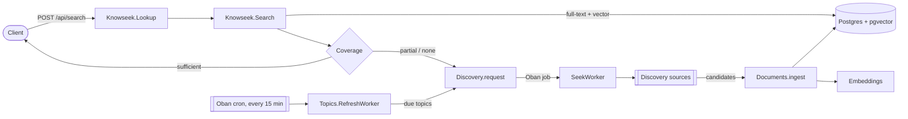
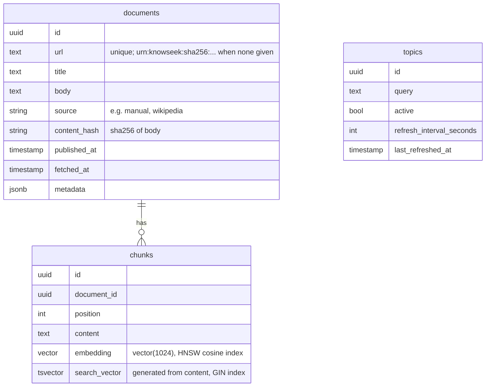

# Architecture

## Overview

A search returns right away with whatever the index has. Discovery runs in the background, so its results are available to later searches, not to the search that triggered it. (Pushing late results to the caller is a backlog task.)

## Components

All modules live in `backend/lib/knowseek/`.

| Module | Responsibility |
| --- | --- |
| `Knowseek.Lookup` | Entry point for a query. Searches, then requests discovery if coverage is not sufficient. |
| `Knowseek.Search` | Read-only hybrid search over chunks. Full-text (`tsvector`) and vector (cosine, HNSW) results are merged with reciprocal rank fusion. |
| `Knowseek.Search.Coverage` | Heuristic that classifies a hit list as `:sufficient`, `:partial`, or `:none`. |
| `Knowseek.Documents` | The only write path into the index. Validates, chunks, embeds, and stores documents. Re-ingesting a URL updates it; an unchanged body is skipped. |
| `Knowseek.Documents.Chunker` | Splits a body into chunks of at most ~1200 characters on paragraph and word boundaries. |
| `Knowseek.Embeddings` | Behaviour plus dispatcher for embedding providers. Takes `input_type: :document \| :query`. Adapters, selected by `EMBEDDINGS_ADAPTER`: `Embeddings.Hashing` (local stand-in, no semantics; the default and in tests), `Embeddings.Ollama` (local `bge-m3` through Ollama, free), `Embeddings.Voyage` (Voyage AI API). |
| `Knowseek.Discovery` | Enqueues and runs discovery. Calls each configured `Discovery.Source` and ingests the candidates. |
| `Knowseek.Discovery.Source` | Behaviour for an external data source. **No real implementations yet.** |
| `Knowseek.Topics` | Topics a user follows. `RefreshWorker` (cron) requests discovery for due topics. |
| `KnowseekWeb.*` | JSON API. Controllers are thin and call the contexts above. |

## Data model

Oban stores its jobs in `oban_jobs` in the same database.

## Background jobs (Oban)

| Queue | Workers | Notes |
| --- | --- | --- |
| `discovery` | `Discovery.SeekWorker` | Unique per normalized query for 1 hour. 3 attempts. |
| `default` | `Topics.RefreshWorker` | Cron, every 15 minutes. |

## Configuration

`backend/config/config.exs` holds the knobs:

- `Knowseek.Embeddings`: `adapter`, `dimensions` (must match the migration).
- `Knowseek.Embeddings.Ollama`: `base_url`, `model`, `max_batch_size`, `req_options`. Set from `OLLAMA_URL` and `OLLAMA_MODEL` in `config/runtime.exs`.
- `Knowseek.Embeddings.Voyage`: `model`, batch limits, `req_options`. `api_key` comes from `VOYAGE_API_KEY` in `config/runtime.exs`.
- `Knowseek.Search`: `default_limit`, `min_similarity`, `min_strong_hits` (coverage heuristic).
- `Knowseek.Discovery`: `sources` (list of modules).
- `Oban`: queues and cron.

Secrets (API keys) go in `config/runtime.exs`, read from environment variables.

## Known limitations

- With the default `EMBEDDINGS_ADAPTER=hashing`, search matches words, not meaning.
- Chunks are not re-embedded when the embedding adapter changes.
- Coverage ignores freshness, so a topic with old data still counts as covered.
- No discovery sources, so discovery jobs currently ingest nothing.
- No authentication and no users. Topics are global.
- The caller is not told when discovery finishes.

Each limitation has a task in `docs/tasks/`.
