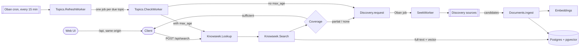
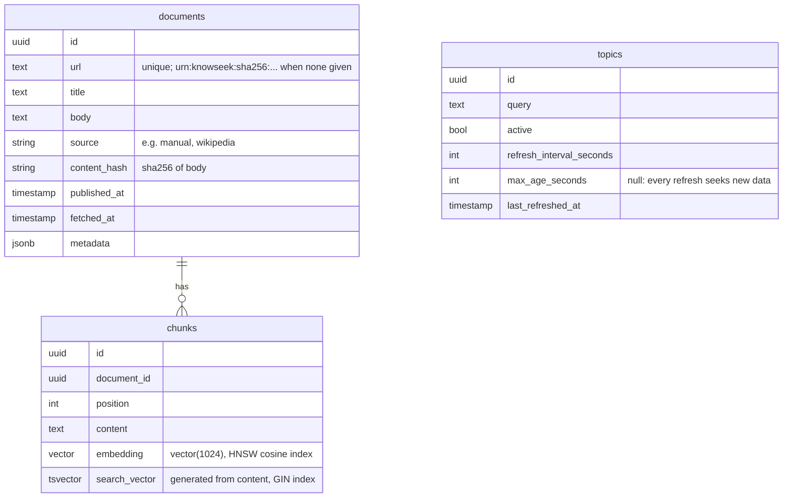

# Architecture

## Overview

A search returns right away with whatever the index has. Discovery runs in the background, so its results are available to later searches, not to the search that triggered it. (Pushing late results to the caller is a backlog task.)

## Components

All modules live in `backend/lib/knowseek/`.

| Module | Responsibility |
| --- | --- |
| `Knowseek.Lookup` | Entry point for a query. Searches, then requests discovery if coverage is not sufficient. |
| `Knowseek.Search` | Read-only hybrid search over chunks. Full-text (`tsvector`) and vector (cosine, HNSW) results are merged with reciprocal rank fusion. Chunks that are not relevant are dropped, so an uncovered query returns no hits. |
| `Knowseek.Search.Coverage` | Pure heuristic that classifies a hit list as `:sufficient`, `:partial`, or `:none`. It counts distinct documents with a relevant hit. With `max_age_seconds`, it counts only documents whose `fetched_at` is within that many seconds. |
| `Knowseek.Documents` | The only write path into the index. Validates, chunks, embeds, and stores documents. Re-ingesting a URL updates it. An unchanged body is not re-chunked or re-embedded, but the other fields and `fetched_at` are updated. |
| `Knowseek.Documents.Chunker` | Splits a body into chunks of at most ~1200 characters on paragraph and word boundaries. |
| `Knowseek.Embeddings` | Behaviour plus dispatcher for embedding providers. Takes `input_type: :document \| :query`. Adapters, selected by `EMBEDDINGS_ADAPTER`: `Embeddings.Hashing` (local stand-in, no semantics; the default and in tests), `Embeddings.Ollama` (local `bge-m3` through Ollama, free), `Embeddings.Voyage` (Voyage AI API). |
| `Knowseek.Discovery` | Enqueues and runs discovery. Calls each configured `Discovery.Source` and ingests the candidates. |
| `Knowseek.Discovery.Source` | Behaviour for an external data source. |
| `Knowseek.Discovery.Sources.Wikipedia` | Searches English Wikipedia (MediaWiki API) and returns the plain text of the top 3 articles, capped at ~40k characters each. Skips disambiguation pages. |
| `Knowseek.Topics` | Topics a user follows. `RefreshWorker` (cron) enqueues one `CheckWorker` job per due topic. Without `max_age_seconds`, the check requests discovery. With it, the check runs a `Lookup` with that freshness need, so discovery runs only when fresh coverage is not sufficient. |
| `KnowseekWeb.*` | JSON API. Controllers are thin and call the contexts above. |
| `frontend/` | Web UI (Vite, React, TypeScript). A client of the JSON API. See below. |

## Web UI

`frontend/` holds a single-page app. In development, Vite serves it and proxies `/api` to the Phoenix API, so the browser sees one origin and the API needs no CORS. The app keeps its state in the URL (`/?q=...&doc=...`, `/topics`), so searches can be shared.

Because the API does not yet tell callers when discovery finishes (task 006), the UI watches the index. After a search that enqueued discovery, it polls `GET /api/documents` for new document ids. When some arrive, it searches again and marks the new results. It stops when no new documents arrive for a while, or after 90 seconds. Task 006 replaces this polling. See `docs/decisions/0008-web-frontend.md`.

## Data model

Oban stores its jobs in `oban_jobs` in the same database.

## Background jobs (Oban)

| Queue | Workers | Notes |
| --- | --- | --- |
| `discovery` | `Discovery.SeekWorker` | Unique per normalized query for 1 hour. 3 attempts. |
| `default` | `Topics.RefreshWorker` | Cron, every 15 minutes. Enqueues one `CheckWorker` per due topic. |
| `default` | `Topics.CheckWorker` | Checks one topic. Unique per topic while incomplete. 3 attempts. |

## Configuration

`backend/config/config.exs` holds the knobs:

- `Knowseek.Embeddings`: `adapter`, `dimensions` (must match the migration).
- `Knowseek.Embeddings.Ollama`: `base_url`, `model`, `max_batch_size`, `req_options`. Set from `OLLAMA_URL` and `OLLAMA_MODEL` in `config/runtime.exs`.
- `Knowseek.Embeddings.Voyage`: `model`, batch limits, `req_options`. `api_key` comes from `VOYAGE_API_KEY` in `config/runtime.exs`.
- `Knowseek.Search`: `default_limit`, `min_similarity`, `min_strong_hits`, `max_age_seconds`. `min_similarity` is the relevance floor: a hit is returned and counted for coverage only if it matched the full-text search or has at least this cosine similarity. It depends on the embedding model (see `docs/decisions/0009-search-returns-only-relevant-hits.md`). `min_strong_hits` and `max_age_seconds` tune the coverage heuristic. `max_age_seconds` is the default freshness need for a search; `nil` ignores age. `POST /api/search` can override it per request; `null` there ignores age.
- `Knowseek.Discovery`: `sources` (list of modules). `config/test.exs` sets `sources: []`, so tests never call a real source. A test that needs a source passes `sources:` to `Discovery.run/2`.
- `Knowseek.Discovery.Sources.Wikipedia`: `base_url`, `limit`, `max_chars`, `user_agent`, `req_options` (tests put the `Req.Test` plug here).
- `Oban`: queues and cron.

Secrets (API keys) go in `config/runtime.exs`, read from environment variables.

## Deployment

The backend builds into a Mix release image (`backend/Dockerfile`). `docker compose --profile app up --build` runs it next to the compose Postgres. The container creates its database, runs the migrations (`Knowseek.Release.migrate/0`, which includes `CREATE EXTENSION vector`), and serves the API. Environment variables are listed in `README.md`. The image has no web UI yet (task 018). See `docs/decisions/0014-release-and-container.md`.

## Known limitations

- With the default `EMBEDDINGS_ADAPTER=hashing`, search matches words, not meaning.
- Chunks are not re-embedded when the embedding adapter changes.
- Wikipedia is the only discovery source, so discovery finds only encyclopedic data.
- No authentication and no users. Topics are global.
- The caller is not told when discovery finishes. The web UI polls for new documents instead.

Each limitation has a task in `docs/tasks/`.
