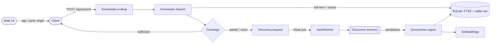
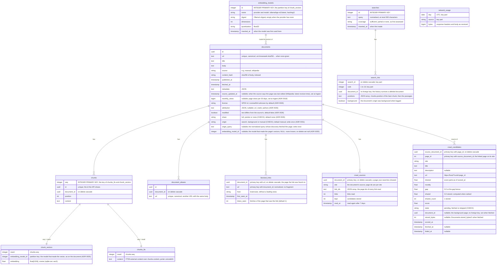

# Architecture

## Overview



A search returns right away with whatever the index has. Discovery runs in the background, so its results are available to later searches, not to the search that triggered it. (Pushing late results to the caller is a backlog task.)

## Components

All modules live in `backend/lib/knowseek/`.

| Module | Responsibility |
| --- | --- |
| `Knowseek.Lookup` | Entry point for a query. Searches, hands the search to `Knowseek.Activity.record_search/4` (a message, no write; ADR 0031), then requests discovery if coverage is not sufficient, and says how far a re-embed is (`reembedding`, ADR 0035). When a budget is used up the request is refused and the search says so (`discovery` is `{:refused, :disk \| :network}`; ADR 0034). |
| `Knowseek.Search` | Read-only hybrid search over chunks. Full-text (FTS5 `chunks_fts`, ranked by `bm25`, with the query built by `Search.FtsQuery`) and vector (sqlite-vec `chunk_vectors`, cosine, an exact scan, over the current embedding model's vectors only: while a page's vectors are being redone it is found by keyword only; ADR 0035) results are merged with reciprocal rank fusion. Chunks that are not relevant are dropped, so an uncovered query returns no hits. The rest are grouped by document: one hit per document, scored by its best chunk (never a sum), with up to `max_passages` other matching chunks in `passages` (`chunk_id`, `content`, `score`). Then a bounded prior from the document's `monthly_views` multiplies that score and the hits are sorted again (see "Ranking prior"). See "Search index" and [ADR 0030](decisions/0030-sqlite-single-datastore.md). |
| `Knowseek.Search.count_near/2` | How many stored documents have a chunk at or above `min_similarity` to a vector of the current embedding model, at most `:limit` (10); 0 when no vector of that model exists (ADR 0035). The vector side of search only (no keywords, no prior, no log). The background crawl uses it as "how many pages near this are already stored" (ADR 0033). |
| `Knowseek.Search.FtsQuery` | Pure: turns the query text into an FTS5 `MATCH` expression, the way Postgres's `websearch_to_tsquery` read it. Every word is quoted (no user text reaches FTS5 as syntax) and ANDed; Postgres's English stop words are dropped outside phrases; `"a phrase"`, `or` and `-word` are translated. `nil` when nothing is left: the search then has no keyword list. |
| `Knowseek.Search.Coverage` | Pure heuristic that classifies a hit list as `:sufficient`, `:partial`, or `:none`. Each hit is one document, so it counts documents with a relevant, fresh hit. With `max_age_seconds`, it counts only documents whose `fetched_at` is within that many seconds. |
| `Knowseek.Documents` | The only write path into the index. Validates, canonicalizes the URL, chunks, embeds, and stores documents. Re-ingesting a URL updates it. `source_updated_at` (when the source says the page was last edited) is stored like `monthly_views`: a candidate without it leaves the stored value alone, and an unchanged body still updates it, because the field means "the source says last edited" and not "our text changed". The license fields (`license`, `attribution`, `modified`, `share`, [ADR 0026](decisions/0026-per-document-license-fields.md)) follow the same rule; a new document without them is `LicenseRef-unknown` and `share: none`. A body that is long enough (`min_alias_body_length/0`) and already stored under another URL is not a new document: the URL becomes an alias of the stored one, and only that document's `fetched_at` moves (a document that has only a `urn:` URL takes the real URL instead). An alias URL that later serves a different body loses its alias and becomes a new document. An unchanged body at a document's own URL is not re-chunked or re-embedded, but the other fields and `fetched_at` are updated. See `docs/decisions/0013-url-canonicalization-and-aliases.md`. `origin` (`search`, `background`, `manual`) and `origin_query` say why a page was first fetched; they are write-once, set only for a new document (a new document without them is `manual`), and `count_by_origin/0` counts the pages of each origin (ADR 0031). Every page records the embedding model of its vectors (`embedding_model_id`, ADR 0035). |
| `Knowseek.Documents.current_model_id/0`, `model_since/0`, `reembedding?/0`, `reembed_progress/0`, `index_status/0`, `reembed_stale/1`, `check_model/0` | The embedding model record (#84, ADR 0035). `current_model_id/0` is the row id of the configured model, nil while no vector of it exists; `model_since/0` when it was first used (the crawl ignores older scores); `reembedding?/0` whether a page has another model's vectors; `reembed_progress/0` `%{done, total}` in passages or nil (the search page); `index_status/0` the model and the counts, with an ETA from a fixed `ms_per_passage` (`/stats`); `reembed_stale/1` embeds the next stale pages again (`Documents.Reembed`: delete and insert the vector rows under the same `seq`, stamp the page; chunks, full text and ids are untouched); `check_model/0` asks the provider which model it serves and enqueues the re-embed job when pages are stale. Internal: `Documents.Lineage` (the model rows and the stale queries), `EmbeddingModel`. |
| `Knowseek.Documents.ModelWatch` | A supervised timer that runs `Documents.check_model/0` right after the start and then every minute, and logs when the re-embed starts or finishes; the fourth exception to rule 6 next to `Cache`, `Activity.Recorder` and `Crawl.Scheduler` (ADR 0035). |
| `Knowseek.Documents.ReembedWorker` | The Oban job (queue `index`) that runs `Documents.reembed_stale/1` (20 pages, passages in requests of 4) and, while pages are left, enqueues itself again. |
| `Knowseek.Documents.indexed_page_ids/2`, `summaries/1` | Reads for the crawl (ADR 0033). `indexed_page_ids(source, page_ids)` is the set of page ids already stored for a source, from `metadata.pageid`, through the expression index `documents_source_pageid_index` (no body is read). `summaries(ids)` is the title and URL of each document that still exists. |
| `Knowseek.Documents.URL` | Pure URL canonicalization: lowercase scheme and host, no fragment, no default port, no tracking parameters (`utm_*`, `fbclid`, ...), sorted query. The tracking list lives there. |
| `Knowseek.Documents.Chunker` | Splits a body into chunks of at most ~1200 characters on paragraph and word boundaries. |
| `Knowseek.Embeddings` | Behaviour plus dispatcher for embedding providers. Takes `input_type: :document \| :query`. Adapters, selected by `EMBEDDINGS_ADAPTER`: `Embeddings.Ollama` (local `bge-m3` through Ollama, free; the default, ADR 0016), `Embeddings.Hashing` (local stand-in, no semantics; the opt-out and the adapter in tests), `Embeddings.Voyage` (Voyage AI API). Each adapter says which model it is (`model/0`; Ollama reads its digest from `GET /api/tags`); `Embeddings.model/0` remembers the answer and `refresh_model/0` asks again (ADR 0035). |
| `Knowseek.Discovery` | Enqueues and runs discovery. Calls each configured `Discovery.Source` and ingests the candidates, each with `origin: "search"` and the normalized query as `origin_query` (a source never sets them), then logs the links of each candidate that point to hosts off the allowlist (`blocked_links`, see "Allowlist and blocked links"). Around each source it counts the downloaded bytes in memory (the `:on_bytes` option of `discover/2` and `links/2`) and, after the source returned (also after a failure), records the total with `Activity.record_bytes/2` (ADR 0031). `request/1` refuses with `{:error, {:budget, reason}}`, and enqueues nothing, when `Activity.hold(:search)` gives a reason; `SeekWorker` checks again when it runs and cancels (ADR 0034). `allowed?/1` is the gate a crawler calls before it fetches a URL. `link_candidates/1` lists the pages a stored page links to on its site, and `fetch_page/3` fetches one of them (the link and the page's own URL must pass `allowed?/1`) and ingests it with `origin: "background"` and no `origin_query` (the background crawl, #89, ADR 0033); both count the downloaded bytes like a search does. `backfill_links/0` enqueues one `Discovery.LinkBackfillWorker` job per indexed page. |
| `Knowseek.Discovery.link_candidates/1` | The pages a stored page links to on its own site, with short descriptions, from its source's `link_candidates/2`, for the background crawl (ADR 0033). Links off the allowlist are dropped; the bytes downloaded are recorded like a discovery run's. `{:ok, []}` for a source without the callback or a URL off the allowlist. |
| `Knowseek.Discovery.Source` | Behaviour for an external data source. A candidate may carry `:links` (the page's outgoing links); the optional callback `links/2` re-reads a stored page's links for the backfill, and the optional callback `link_candidates/2` returns a stored page's links with their page ids, titles and short descriptions for the crawl (ADR 0033). |
| `Knowseek.Discovery.Sources.MediaWiki.link_candidates/3` | One `generator=links` request (redirects resolved; two at most for a page with more than 500 links) with `prop=description`. Red links, disambiguation pages, pages outside the site's `link_namespaces` (default `[0]`; Wikibooks also keeps the Cookbook) and the page itself are left out. Wikipedia and Wikibooks implement `link_candidates/2` with it. |
| `Knowseek.Discovery.Allowlist` | Pure, internal to `Discovery`: the allowed hosts from config, and `parse/1`, which turns a link into the form the log stores (lowercase scheme and host, no fragment, at most 2,000 bytes) or `:error` when it is no web link. Hosts match exactly after a leading `www.` is dropped. |
| `Knowseek.Discovery.Sources.MediaWiki` | The shared MediaWiki Action API code of the Wikipedia and Wikibooks sources (ADR 0029). Given a site (source name, `api.php` URL, license, credit, config key, optionally `search_namespaces`), it searches and returns the plain text of the top 3 pages, capped at ~40k characters each, with each page's views per 30 days (`monthly_views`, from `prop=pageviews` in the same request) and the time of its latest revision (`source_updated_at`, from `prop=revisions`). It searches the main namespace, or one search per namespace in `search_namespaces`, earlier namespaces' pages first, without duplicates. Each page is credited to the site with a link to the page, `modified` and `share: full` (ADR 0026). Each candidate carries `:links`, the page's external links (`prop=extlinks`, same request; at most 500 a response, and up to 10 continuation requests for the links alone when a page has more; ADR 0032). `links/3` reads the links of a stored page (one request plus continuations). Skips disambiguation pages. Its requests are `:background` callers of `Knowseek.Wikimedia`. `link_candidates/3` lists a page's same-site links with their short descriptions (`generator=links`, one request, two for more than 500 links) and `page/3` fetches one page by its id, with the request, fields and `:links` of a discovered page (#89, ADR 0033). `discover/3`, `links/3`, `link_candidates/3` and `page/3` take `:on_bytes`: `Knowseek.Download.measure/2` adds a Req response step that reports the size of each response, headers and body as received (compressed, once per attempt; ADR 0034). |
| `Knowseek.Discovery.Sources.Wikipedia` | English Wikipedia over `MediaWiki`, for every query. `CC-BY-SA-4.0`, credit "Wikipedia". |
| `Knowseek.Discovery.Sources.Wikibooks` | English Wikibooks over `MediaWiki`, only for a question (`question?/1`: ends with `?`, or starts with how, why, can, could, should, do I, is it, what's the best; ADR 0029). It searches without the question lead-in (`search_text/1`: "how do i cook eggs" searches "cook eggs"), twice: the Cookbook namespace (102, recipes such as *Cookbook:Hard Cooked Eggs*) first, then the main namespace; recipes come first and keep their `Cookbook:` title. It skips compilations: pages that transclude 2 or more main-namespace pages, such as print versions. `CC-BY-SA-4.0`, credit "Wikibooks". Its page views are on Wikibooks' smaller scale. |
| `Knowseek.Entities` | Entity resolution (ADR 0017). `resolve(query, opts)` turns a query into `{:ok, %{intent, entity, alternatives}}`, `:none`, `{:pending, query}` (cold cache) or `{:error, reason}`. It reads only the cache; a cold query starts one background fetch. `Entities.Intent` splits `weather in <place>` and `<place> weather` into intent `:weather` and the place. `Entities.Resolver` is the behaviour for a resolver; `Entities.Wikidata` (`wbsearchentities` for candidates, one `wbgetentities` for claims) is the configured one. The top entity is the first candidate whose type a card provider handles (`kind/1`, the `supported_types` config); the other candidates of that kind, at most 5, are the alternatives. The cache holds the candidates, and the top entity is chosen when the answer is read: for the weather intent a place is chosen by sitelinks (`weather in new york` is the city, not the state; ADR 0022). `Entities.Entity` is the struct. |
| `Knowseek.Cache` | A disposable in-memory cache (ETS) with a supervised background refresher: `get(cache, key, fetch_fun, opts)` never fetches in the caller. Single-flight per key, TTL (a number or a function of the value), stale-while-revalidate, the old value kept on failure, a backoff after a failure, a fetch timeout, a cap on entries, a cap on concurrent fetches (`max_in_flight`: a refresh over the cap is dropped, the next `get` asks again), and a cache-wide stop on a rate limit (a fetch that fails with `{:rate_limited, ms}`, see `Cache.rate_limited/1`, stops every fetch of that cache for `Retry-After`, at most ten minutes). Entity resolution (`Knowseek.Entities.Cache`) and the cards (one `Knowseek.Cards.Cache.<Provider>` per card provider, so a rate limit stops only that upstream's cards, and `Knowseek.Cards.NbaTeams`) each use an instance. `reserve_for_refresh` keeps some of the slots for refreshes of keys that hold a value, so a flood of new keys cannot starve those refreshes (it does not protect new keys), and eviction drops the entries with the fewest reads first (ADR 0023). |
| `Knowseek.Cards` | Live fact cards (ADR 0017). `get(entity, opts)` returns `:none` (no provider handles the entity) or `%{status, type, title, facts, as_of, refresh_after_ms}` with status `fresh`, `stale`, `pending` or `unavailable`. It reads only the cache and never calls a provider: a cold or expired card starts one background fetch. `Cards.Provider` is the behaviour (`handles?/1`, `fetch/1` returning `{:ok, card, ttl_ms}`); the providers are the `providers` config. `Cards.Providers.Nba` (with `Cards.Balldontlie`, the HTTP client) makes the NBA team card (ADR 0028). Each provider has its own cache (`cache_name/1`). `Cards.Providers.OpenMeteo` (with `Cards.OpenMeteo`) makes the weather card of a place (ADR 0022); a provider that defines the optional `intent/0` is used only when the query carried that intent (`get/2` option `:intent`). |
| `Knowseek.RateLimiter` | An in-memory token bucket per key (ADR 0023): `hit(key, limit, window_ms)` returns `:ok` or `{:error, retry_after_ms}`. One process owns the buckets; full ones are swept, at most `max_buckets` are kept. Only `KnowseekWeb.Plugs.RateLimit` calls it. |
| `Knowseek.Wikimedia` | The cap on Wikimedia requests at once (ADR 0027): 3 slots across Wikipedia, Wikibooks and Wikidata. `run(class, fun)` holds a slot while `fun` runs. `Entities.Wikidata` is `:interactive` (served first, any slot); the `Discovery.Sources.MediaWiki` sources are `:background` (at most 2 slots). |
| `Knowseek.Download` | What an HTTP response cost on the wire, for the network budget (ADR 0034): `size/1` is the headers (HTTP/1.1 text size) plus the body as received. `measure/2` adds a Req response step that calls a function with each response's size (it runs before `retry` and `decompress_body`); `count/2` is `measure/2` with the configured sink (`Activity.count_bytes/2`), for the clients that run outside a discovery job: `Entities.Wikidata` (`wikidata`), `Cards.Edgar` (`edgar`), `Cards.OpenMeteo` (`open_meteo`), `Cards.Balldontlie` (`balldontlie`), `Embeddings.Voyage` (`voyage`). The local Ollama is not counted. |
| `Knowseek.Activity` | A local record (#96, ADR 0031) and the budgets (#90, ADR 0034). The record: every search (normalized query, first coverage, the top 10 hits down to the chunk position), the bytes each source downloads per UTC day (headers and bodies, every HTTP client), and `stats/1`, the numbers over both and over the pages' origins. `record_search/4` only sends a message to `Activity.Recorder`; `record_bytes/3` is a direct upsert called by discovery jobs and by the recorder; `count_bytes/2` sends the recorder a byte count and returns (for downloads outside jobs). The budgets: `budget/1` reads the disk in use (the file's pages in use plus its write-ahead log), today's bytes and the free space of the database's volume (`:disksup`) and gives each budget a level (`ok`, `near`, `full`); `hold/2` says why `:background` work (the crawl and the link backfill: disk or network at 90%, or free space below the floor or unreadable) or `:search` fetching (disk or network at 100%) must not start, or `nil`. `Activity.Budget` is the pure rules. Internal: `SearchLog` (the writes), the schemas `SearchRecord`, `SearchHit`, `NetworkUsage`. It never reads `documents` (it asks `Documents.count_by_origin/0` and `Documents.count_chunks/0`). `stats/1` also holds `gain` (#89): the searches whose logged results hold a background page and fewer than `min_strong_hits` other pages, and the background pages in them, and `budget` and `passages`. `hit_documents/1` says which documents appeared in a logged search. |
| `Knowseek.Activity.Recorder` | The supervised in-process writer of the search log and of byte counts, a second exception to rule 6 next to `Knowseek.Cache`. No state; one per node. See "Activity record". |
| `Knowseek.Activity.result_pages/1`, `last_search_at/0` | Reads of the search log for the crawl: the documents in the logged results of the last 30 days with their appearances (rank, and whether the search had one result; background pages left out), and the time of the newest logged search. |
| `Knowseek.Crawl` | The background crawl (#89, ADR 0033). `due?/1`, `next_action/1` and `step/1` (one action: read and score the links of one source page, or, in mode `on`, fetch the best candidate after a re-check), `overview/1` (the Crawl page: the next candidates and the fetched pages, and `paused`: why a budget holds it back, or `nil`), `stats/1` (the crawl counters of `/stats`), `clear_pending/0`. `due?/1` and `step/1` do nothing while `Activity.hold(:background)` gives a reason (ADR 0034). Reaches a source only through `Discovery.link_candidates/1` and `Discovery.fetch_page/3`, the log through `Activity`, the index through `Documents` and `Search.count_near/2`. Not due while a re-embed runs; candidates scored with an older embedding model are ignored and their source pages read again (ADR 0035). See "Background crawl". |
| `Knowseek.Crawl.Allowance` | Pure: the source pages from the logged results and what each has earned (5 for a top-3 rank, 15 as the only result, 1 for a lower rank) and whether it was a single result (the gap bonus). |
| `Knowseek.Crawl.Score` | Pure: the text scored (`Title: description`), `interest`, `novelty`, the base score, `rarity` and the shared bonus. |
| `Knowseek.Crawl.Idle` | Whether the instance is idle: no logged search for `idle_seconds` and the CPU busy share since the previous check (`:cpu_sup.util/0`, `os_mon`; sampled per calling process, so only the scheduler asks) under `max_cpu_percent`. The first check and an unreadable share mean not idle. |
| `Knowseek.Crawl.Frontier` | The queries and writes of the two tables (`crawl_sources`, `crawl_candidates`), each write one short transaction after the external calls. Internal to `Crawl`, with the schemas `SourcePage` and `Candidate`. |
| `Knowseek.Crawl.Scheduler` | A supervised timer, once a minute. Only reads (`Crawl.due?/1`) and enqueues one `Crawl.Worker` job; the third exception to rule 6 next to `Cache` and `Activity.Recorder` (ADR 0033). |
| `Knowseek.Crawl.Worker` | The Oban job (queue `crawl`) that runs `Crawl.step/1`. |
| `KnowseekWeb.*` | JSON API. Controllers are thin and call the contexts above. `CardController` (`GET /api/cards?q=`) composes `Entities.resolve/2` and `Cards.get/2`. `StatsController` (`GET /api/stats`, `DELETE /api/searches`) calls `Activity`. `Plugs.RateLimit` (an endpoint plug before the body parsers) limits the three anonymous endpoints per client (`ClientIp` decides who the client is). |
| `frontend/` | Web UI (Vite, React, TypeScript). A client of the JSON API. See below. |

## Web UI

`frontend/` holds a single-page app. In development, Vite serves it and proxies `/api` to the Phoenix API, so the browser sees one origin and the API needs no CORS. The app keeps its state in the URL (`/?q=...&doc=...`), so searches can be shared.

Because the API does not yet tell callers when discovery finishes ([#49](https://github.com/williamge/knowseek/issues/49)), the UI watches the index. After a search that enqueued discovery, it polls `GET /api/documents` for new document ids. When some arrive, it searches again and marks the new results. It stops when no new documents arrive for a while, or after 90 seconds. Issue [#49](https://github.com/williamge/knowseek/issues/49) replaces this polling. See `docs/decisions/0008-web-frontend.md`.

The app has one page besides search: `/stats` (`StatsPage.tsx`, from `GET /api/stats`): searches per day with their coverage mix, pages by origin, hit share, gain (and the bytes stored per useful page), the crawl counters, the embedding model with the re-embed progress (the search page shows one line while a re-embed runs), a Disk section (the disk budget as a bar, the free space of the disk, the passage count, with a note from 100,000 passages) and a Network section (today's budget as a bar, and the network bytes per day and source), notices in words when a budget is at 90% or used up (the bars also change colour), and a button that clears the search history. A row of links at the bottom of every page (`SiteNav.tsx`) opens it, and the wordmark returns home. Pages are routed by path (`PAGE_PATHS` in `router.ts`). When a search was refused a fetch (`discovery.status` is `refused`), the status line says which budget is used up (ADR 0034).

The app also has a page at `/blocked-links` (`BlockedLinksPage.tsx`), shown from `GET /api/blocked-links` as a table by domain (links, pages, times seen, first seen, an example link), with a button that starts the backfill (`POST /api/blocked-links/backfill`). See "Allowlist and blocked links".

The page `/crawl` (`CrawlPage.tsx`, from `GET /api/crawl`) is read-only. It shows the crawl mode, the bar, the pages fetched today out of the daily cap, a line saying why the crawl is paused when a budget holds it back (`paused`; ADR 0034), the candidates the crawl would fetch next ("Next": title and description, the page whose links it was found on, which opens in the document reader over the crawl page (`/crawl?doc=ID`), the searches that showed that page, and the score parts; the candidate's title links to its own page in a new tab) and the last 50 pages it fetched ("Fetched": the same columns, plus when, and whether a search of yours showed the page). There are no buttons. See "Background crawl".

## Data model



The database is one SQLite file (ADR 0030): `backend/data/knowseek_dev.db` in development, `DATABASE_PATH` in a release. UUIDs and timestamps are TEXT, maps JSON TEXT. Oban stores its jobs in `oban_jobs` in the same file.

### Search index

`chunks_fts` and `chunk_vectors` are virtual tables keyed on `chunks.seq`. `chunks_fts` is an FTS5 external-content table (the text is stored once, in `chunks`); `chunk_vectors` is a sqlite-vec `vec0` table of float32 vectors. The partition key `embedding_model_id` of `chunk_vectors` keeps one model's vectors apart from another's (ADR 0035). Triggers on `chunks` keep both in step: an insert adds the full-text entry, a delete (also through the cascade from `documents`) removes the full-text entry and the vector, an update of `content` replaces the full-text entry. `Documents.ingest/1` inserts the chunks with `RETURNING seq, position` and then their vectors, in one transaction. There is no approximate index: a vector search compares the query with every vector (about 2 ms per 1,000 chunks on sqlite-vec 0.1.9), so there are no dead entries and nothing to vacuum or reindex. The vector list is capped at 4,096 candidates (sqlite-vec's `k` limit).

`Knowseek.Repo` loads the sqlite-vec extension (v0.1.9, `priv/sqlite_vec/vec0`) into every connection; `mix sqlite_vec.fetch` downloads it and checks its SHA-256. Every transaction starts IMMEDIATE (one writer at a time; a reader never waits, WAL mode).

## Activity record

[ADR 0031](decisions/0031-activity-record.md). A local record to judge whether crawling is worth it.

- **The search log.** `Lookup.run/2` sends each successful search to `Knowseek.Activity.Recorder` (`Activity.record_search/4`, a `GenServer.cast`) and returns. The recorder writes the `searches` row and up to 10 `search_hits` outside the request, so a search never takes the write lock for the log. A write that fails is logged as a warning and dropped; the recorder never crashes on it. `Search.search/2` called directly logs nothing.
- **One search.** A search with the same normalized query as a logged search less than 120 seconds old is the same search (the UI repeats a search while discovery runs): the row keeps its time and first coverage and takes the newest hits. The recorder checks the newest 20 rows.
- **Hits** store the document id (no foreign key), the `chunks.position` of the best chunk and of the passages shown, and `background` (the document's origin was `background`). `Search.Hit` carries `position` and `origin` for this; the search response (`SearchJSON`) does not show them.
- **The byte counter.** Every HTTP client counts what it downloads: the size of a response is its headers (HTTP/1.1 text size) plus the body as received, compressed (`Knowseek.Download.size/1`; request bytes, TLS and the local Ollama are not counted). `Discovery` gives each source `on_bytes`, a function that adds to an in-memory counter; after the source returned, `Discovery` writes the total to `network_usage` (per UTC day and source: `wikipedia`, `wikibooks`). The other clients (`wikidata`, `edgar`, `open_meteo`, `balldontlie`, `voyage`) send each response's size through `Activity.count_bytes/2` as one message to `Activity.Recorder`, which writes it with `record_bytes/3`: no write in the request path, best effort like the search log, and the count can only be low. Days recorded before ADR 0034 hold bodies of discovery sources only.
- **Hit share:** the background pages that appeared in the top results of a logged search, out of all background pages. Only the background crawl writes background pages (mode `on`, ADR 0033); with none it is 0 of 0.
- **Gain** (#89, ADR 0033): from the log alone. A search counts when at least one of its logged hits is a background page (the hit's `background` flag is written at search time, so the search came after the fetch) and fewer than `min_strong_hits` (3) are not. `gain.pages` is the number of distinct background pages in such searches (whole log), `gain.searches` those searches in the last 30 days, `gain.window_searches` all searches in the last 30 days. No second search is run. `/stats` also shows the stored bytes per useful page: `crawl.stored_bytes` (an estimate: body, chunk text and 4 bytes per vector dimension per chunk, `Documents.stored_bytes/1`) divided by `gain.pages`.
- **`GET /api/stats`** reads all of it (searches per day by coverage and pages by origin, the passage count, the budgets, network per day and source, hit share, gain), over the last 30 UTC days. `DELETE /api/searches` clears the log.
- **Budgets** ([ADR 0034](decisions/0034-budgets.md)). `Activity.budget/1` computes one state from three cheap readings: the disk in use (the file's pages in use plus the write-ahead log; free pages do not count, the holes of deleted vectors do), the bytes counted today (UTC, all sources) and the free space of the database's volume (`:disksup`; skipped when `min_free_disk_bytes` is 0). `Activity.hold/2` turns it into a reason or `nil`: `:background` (the crawl and the link backfill) is held at 90% of either budget (`background_share`), and also when free space is below `min_free_disk_bytes` (1 GB) or cannot be read; `:search` (the fetches of a typed search) only at 100%, and it reads no free space. Each check is made before an action, with no reservation, so one action in flight can pass a budget. The checks sit in the callers (`Crawl.due?/1` and `step/1`, `LinkBackfillWorker`, `Discovery.request/1`, `SeekWorker`), not in `Documents.ingest/1`: a page you add by hand is never refused, and Wikidata and the cards are counted and never refused. `GET /api/stats` shows the state as `budget` (`disk`, `network`, `free_disk`, `background_share`) and `passages`.

## Background jobs (Oban)

| Queue | Workers | Notes |
| --- | --- | --- |
| `discovery` | `Discovery.SeekWorker` | Unique per normalized query for 1 hour. 3 attempts. Cancels (`{:cancel, {:budget, reason}}`, no source is called) when `Activity.hold(:search)` gives a reason when it runs (ADR 0034). |
| `discovery` | `Discovery.LinkBackfillWorker` | One job per indexed page: logs its blocked links without counting them (ADR 0032). Unique per document while incomplete. 3 attempts. Priority 3, so search-time `SeekWorker` jobs (priority 0) go first. Scheduled two a second. Waits 24 hours (`{:snooze, 86_400}`, a fixed wait so that its pace holds) when `Activity.hold(:background)` gives a reason (ADR 0034). |
| `crawl` | `Crawl.Worker` | One job runs `Crawl.step/1`: read and score the links of one source page, or fetch one page (ADR 0033). Enqueued by `Crawl.Scheduler`, at most one incomplete job (unique), concurrency 1, 1 attempt: the next tick is the retry. |

| `index` | `Documents.ReembedWorker` | Re-embeds the passages of pages whose vectors come from another embedding model, 20 pages a job, in requests of 4 passages (ADR 0035). Enqueued by `Documents.ModelWatch` and by itself while pages are left; unique while waiting (not while executing), concurrency 1, 5 attempts. |

## Embedding model record

[ADR 0035](decisions/0035-embedding-model-record.md). Vectors of two models cannot be compared, so the model is recorded and a change is repaired by itself.

- **The record.** `embedding_models` has one row per model (name, digest, dimensions, quantization) that made vectors stored here. A page's `documents.embedding_model_id` says which one made its vectors, and each vector carries the same id as the partition key of `chunk_vectors`. A search and the crawl's novelty count (`Search.count_near/2`) filter the vector query by the current model's id.
- **Which model is current.** `Embeddings.model/0`: the configured adapter says (`model/0` callback), remembered in `:persistent_term` while the adapter stays the same. `ModelWatch` calls `Embeddings.refresh_model/0` once a minute (through `Documents.check_model/0`), so a new Ollama digest is noticed within a minute.
- **Stale pages.** A page is stale when its model id is not the current model's, or is NULL. When any is stale, `ModelWatch` enqueues `ReembedWorker`; each job re-embeds the next 20 pages in storage order and enqueues its successor while pages are left. The vector rows are deleted and inserted again under the same `seq` (a partition key cannot be updated); passages, full text and ids are untouched. When none is stale, the model rows no page uses are deleted.
- **Meanwhile.** Search works: pages not yet redone are found by keyword only. `/api/search` returns `reembedding` and `/api/stats` returns `index`; the search page shows one line and `/stats` the model and the progress. The crawl is not due, ignores candidates scored before the current model's row was created, and reads its source pages again.
- **First start after the migration.** The migration drops and recreates `chunk_vectors` (a vec0 table cannot be altered), so every page is re-embedded.

## Background crawl

[ADR 0033](decisions/0033-background-crawl.md). While the instance is idle, `Knowseek.Crawl` reads the links of the pages your searches showed and scores them. In mode `on` it also fetches the best candidate a minute.

- **Tick.** `Crawl.Scheduler` ticks once a minute. If the crawl is due (mode is not `off`, the instance is idle, no budget holds background work back, a source page is waiting) it enqueues one `Crawl.Worker` job. It is a timer and not Oban's cron plugin, which would insert a job row every minute for a check that is almost always "no". The job runs `Crawl.step/1`: one action, reading one source page or fetching one page.
- **Idle.** No logged search for `idle_seconds` (600) and a CPU busy share under `max_cpu_percent` (60) since the previous tick, so over the last minute (`:cpu_sup.util/0`; the load average is not used, because on macOS it counts threads waiting for the disk). The first tick after a start and an unreadable share mean not idle.
- **Source pages.** The documents in the logged results of the last 30 days (never a background page). Each earns an allowance of link-fetches: 5 per top-3 appearance, 15 as the only result, 1 for ranks 4 to 10. One read is one request (two for a page with more than 500 links) through the Wikimedia background slots and `Discovery.allowed?/1`. A page is read again after 7 days.
- **Score.** For a link on source page `S`: `interest` = the best cosine of "Title: description" with the searches that showed `S`; `novelty` = `1 - near / 10`, `near` = stored pages near the link (`Search.count_near/2`); `gap` = 0.10 if `S` was the only result of a search; `shared` = a bonus up to 0.10 for a link on several source pages, scaled by how rare that is among `S`'s links. `score = interest * novelty + gap + shared`. A link is kept (at most 50 per page) when `interest >= 0.40` and it could reach the bar of 0.40 with the largest shared bonus. The shared bonus is computed when candidates are ranked, because it depends on the other source pages.
- **Modes.** `CRAWL_MODE`: `off`; `preview` (the default: reads and scores, fetches nothing); `on` (also fetches the best candidate a minute, at most 100 a UTC day).
- **Fetching.** When no source page with allowance is left to read, `Crawl.step/1` goes through the first `rechecks_per_step` (5) ranked candidates (score at the bar or more, shared bonus included) and stops at the first one that ends in a request. Each is checked again first: a page indexed meanwhile is dropped; the candidate is embedded again and `near`, `novelty` and the score are recomputed, and a candidate under the bar is dropped without a request (this is why a topic fills up at about 10 pages). Then `Discovery.fetch_page/3` ingests the page with origin `background` (its blocked links are logged too) and the candidate becomes `fetched` with the scores that decided it and `stored_bytes`. A page with no text or a URL off the allowlist is `skipped`; a failed request sets `failed_at` and the candidate waits `retry_minutes`. A fetched page uses one link-fetch of its source page's allowance.
- **Clearing.** `DELETE /api/searches` also clears the link lists and the pending candidates.
- **Budgets** (ADR 0034). `Crawl.due?/1` and `Crawl.step/1` ask `Activity.hold(:background)`: while it gives a reason (disk or network at 90%, free disk space below the floor or unreadable) no job is enqueued, and a job enqueued just before does nothing. This covers link reads and fetches in every mode, `preview` included. `GET /api/crawl` shows the reason as `paused` (`disk`, `network`, `free_disk` or `null`) and the Crawl page says it. The 100-pages-a-day cap stays beside the budgets: whichever comes first.

## Allowlist and blocked links

[ADR 0032](decisions/0032-crawl-allowlist-and-blocked-links.md). A crawler may fetch only from the hosts in `allowed_hosts` (`en.wikipedia.org` and `en.wikibooks.org`); `Discovery.allowed?/1` is the gate it must call before it fetches a URL. Nothing follows a link yet. A link to any other host is logged, not fetched:

- **Finding the links.** The MediaWiki page request already sent adds `prop=extlinks` (`ellimit=max`, 500 links at most a response, up to 10 continuation requests for a page with more). The source returns the links in each candidate (`:links`); it writes nothing.
- **Logging them.** `Discovery.run/2` pops `:links` off the candidate, ingests the rest through `Documents.ingest/1`, then `record_links/3` writes the links to hosts off the list into `blocked_links`, in one transaction of its own. Links to allowed hosts and links that are no web links (`mailto:`) are dropped; allowed and internal links are not stored. One row per page and URL; a link seen again on a later fetch of its page adds 1 to `times_seen`.
- **Reading the log.** `GET /api/blocked-links` returns it by domain (`blocked_domains/1`: distinct links, pages that link there, times seen, first seen, an example link; up to 200 domains, most linking pages first, and totals over the whole log). The page `/blocked-links` shows it.
- **Backfill.** `POST /api/blocked-links/backfill` (the "Scan pages already indexed" button) enqueues one `LinkBackfillWorker` job per indexed document of a source that implements `links/2`. Each job asks the source for that page's links (one small request) and logs the blocked ones without counting them, so it can run twice. The bytes it downloads are counted and recorded for the source like discovery's (ADR 0031).

## Ranking prior

[ADR 0018](decisions/0018-ranking-prior.md). After chunk fusion and grouping, `Knowseek.Search` multiplies each document's score by a factor from `documents.monthly_views` and sorts again (a stable sort, so equal scores keep the fused order):

```
factor = 1 + prior_weight * min(1, log10(1 + views) / log10(1 + prior_saturation_views))
score  = best_chunk_rrf_score * factor
```

- The factor is between 1.0 and `1 + prior_weight` (1.3 by default). It never lowers a score, so relevance dominates: a document at rank 1 in both lists (2/61) is overtaken only by one within about 20 ranks of it. A document with no figure (`NULL`) gets exactly 1.0 and ranks as before. `prior_weight: 0` turns the prior off. Both knobs can be passed to `Search.search/2`.
- 81,520 views give 1.245 and 6,276 give 1.190, a 4.6% lead.
- The figure is taken at ingest (the Wikipedia source reads it from the same API call as the text) and written by `Documents.ingest/1`. It is refreshed only when the document is re-ingested. No mechanism re-fetches an existing document, so the figure can be old. Decided 2026-10-31: no re-fetch for now; revisit when a source where age matters is added (ADR 0018).
- `Hit.score` includes the factor. `passages[].score` do not.

## Live fact cards (built for NBA teams, weather and companies)

[ADR 0017](decisions/0017-live-fact-cards.md) decides that a query about an entity with live state gets a card of structured facts above the ranked results. Built: entity resolution (`Knowseek.Entities`, `Knowseek.Cache`) and the card framework with the NBA team card (`Knowseek.Cards`, `GET /api/cards`, the card above the results in the UI). The weather card (ADR 0022) is built below. The company card (ADR 0021) is built below. Not built: a company price (ADR 0021), weather for bare "weather" ([#55](https://github.com/williamge/knowseek/issues/55)), other leagues, and push instead of polling. The design:

- Entities are resolved through Wikidata. Cards come from swappable provider behaviours: balldontlie (teams, ADR 0028), Open-Meteo (weather) and the SEC's EDGAR (companies).
- The endpoint is cache-only. It reads in-memory caches and never calls a provider or Wikidata in the request path. Its response has `status` (`fresh`, `stale`, `pending`, `unavailable`, `none`), `as_of`, `refresh_after_ms` and the card data.
- A supervised in-process refresher fills the cache, single-flight per entity, with a short timeout and a backoff. The UI polls. Nothing runs when nobody is looking. The cache is disposable: no Oban job, no table. `Knowseek.Cache` is this mechanism: `resolve/2` returns `{:pending, query}` on a cold query and `Cards.get/2` returns `status: :pending` on a cold card, and the caller asks again.
- Rule 6 in `AGENTS.md` is amended accordingly. The request path never calls an external provider, except query embedding in `Search`. Index writes still go through Oban.

### Entity resolution

`Entities.resolve/2` splits the intent word off (`weather in tokyo` gives `:weather` and `tokyo`), then reads the cache entry for the lowercased text. A cold entry starts a fetch: one `wbsearchentities` call (20 candidates), one `wbgetentities` call for all of their claims and sitelinks, then the choice of the top entity. The result, including "no match", is cached for a day. A failure (HTTP 429, timeout) is `{:error, reason}` when nothing is cached, and the old answer is kept when something is. No new fetch starts for a minute after a failure.

An entity has a *kind* when a type it is an instance of (P31) is in the `supported_types` config for that kind and it has what the provider needs: a company needs an exchange ticker (P414 with the P249 qualifier; its SEC Central Index Key, P5531, is read into `Entity.cik` for the company card), a place needs coordinates (P625), a sports team needs nothing more. The list is flat on purpose: Tokyo is a "big city" and a "megacity", not a "city". The config lists the ids seen in the probes.

### Cards and the endpoint

`GET /api/cards?q=<query>` (`KnowseekWeb.CardController`) resolves the query to an entity (`Entities.resolve/2`), asks `Cards.get/2` for its card, and answers `{data: {status, entity, alternatives, card, as_of, refresh_after_ms}}`. The query is the key, so the UI needs no entity id. Alternatives that have the label of the top entity are dropped (the NBA and the old NBL Denver Nuggets are two Wikidata items with one label). Both steps read caches, so a cold query is `pending` twice in a row: first the entity, then the card, one poll apart. `none` means the query names no entity that has a card (a company or a place today, a G League team, text that is not a name): the UI shows nothing. `unavailable` means a source failed and nothing was ever cached. `stale` means a card past its TTL is served while the refresh runs or after it failed, with its old `as_of`. `refresh_after_ms` is when to ask again: 0.7 s for `pending`, the time the card has left (2-60 s) for `fresh`, 2 s for `stale` (a refresh that runs finishes in a second; the UI shows the stale notice only if the card is still stale one poll later, so a normal refresh does not flash it), 30 s for `unavailable`. The UI (`useCard`) polls on these times, pauses while the tab is hidden (and asks at once when it is visible again or the browser is back online, one request at a time), and stops on `none`. It retries `unavailable` and failed requests after 5, 15, 30, 60 and 90 s, which outlasts the 60 s that the entity cache waits after a failed Wikidata call (`backoff` in the `Knowseek.Entities` config; a test pins both). Then it marks a card on screen stale and asks every 30 s (or the server's `refresh_after_ms` if longer) for as long as the tab is visible. A `pending` that lasts 30 s is also asked at that slow cadence.

The NBA team card (`Cards.Providers.Nba`, ADR 0028) needs `BALLDONTLIE_API_KEY` (a free balldontlie account; without it no team is handled and the query has no card). It handles an entity that is a sports team and whose Wikidata league (P118, no ended claims) includes the NBA (Q155223). The league decides, not the label: the Westchester Knicks (G League) and the former Denver Nuggets (an NBL team whose NBA claim has an end date) get no card. The label is then matched to `full_name` in balldontlie's `/teams` list (East and West only, since the list also has former teams; cached for a day; `Los Angeles Clippers` is `LA Clippers`; an answer with fewer than 25 teams, such as an empty or malformed 200, is an error and is not cached). A card needs one request, `/games?team_ids[]=<id>&seasons[]=<year>&per_page=100` (a second page only if `next_cursor` says so): the record (counted from the regular season's final games, without the NBA Cup final), the game in progress, the last final game and the next one. A postponed or cancelled game is left out. No injuries and no standings: they are paid tiers. The TTL follows the state: 30 s while a game is in progress (the free key allows 5 requests a minute), up to 6 hours for a game that tipped off in the last 12 hours (about 9.5 hours after it ended), up to an hour otherwise, never past 2 minutes before the next start and never under a minute. A request has a 4 s timeout, the whole fetch 12 s, and a failure backs off for 10 s. A 401 (a wrong key) is a failure like any other.

Two limits protect the upstreams from user input (the query is user input). The entity cache normalizes its key (lowercase, NFKC, single spaces), drops text that is not a printable name before any fetch, keeps at most 5000 entries, and runs at most 4 Wikidata resolutions at once (a refresh over the cap is dropped, the key stays `pending`, the next poll asks again). A 429 or `maxlag` from Wikidata, or a 429 from a card source, with its `Retry-After`, stops every fetch of that cache until the time is up. Drops over the cap are counted (`Cache.stats/1`) and logged as a warning, at most once every 10 seconds.

`Entities.Wikidata` does not send `maxlag` (an interactive read behind a cache; MediaWiki says interactive tasks "may omit" it). Wikidata counts the lag of its Query Service (wdqs) in `maxlag`, which these two read actions do not use, so with `maxlag=5` every lookup failed whenever wdqs lagged (observed 2026-11-02). A `maxlag` error that still arrives waits for `Retry-After`, clamped to 1 to 300 s. The Wikipedia source keeps its `maxlag` (background job, replica lag).

### Wikimedia concurrency (ADR 0027)

Wikimedia asks for at most 3 requests at once across all its sites. Every Wikipedia and Wikidata request runs inside `Knowseek.Wikimedia.run/3`:

| Caller | Class | Slots | Queue position |
|---|---|---|---|
| `Entities.Wikidata` (entity cache tasks) | `:interactive` | any of the 3 | first |
| `Discovery.Sources.Wikipedia`, `Discovery.Sources.Wikibooks` (`discovery` jobs) | `:background` | at most 2, together | after interactive waiters |

A caller with no free slot waits, with no time limit; the Oban queue (5) and the entity cache (4 in flight) stay as they are. A slot is held for one request, Req's retries included. A caller that dies frees its slot or leaves the queue. The wait of an entity lookup counts towards the cache's 15 s timeout. The cap is per node.

### Limits on anonymous input (ADR 0023)

The query is user input, and there is no authentication yet (see #86), so three layers protect the upstreams and the other clients:

1. **Per-client rate limit** (`KnowseekWeb.Plugs.RateLimit` in the endpoint, before `Plug.Parsers`; `Knowseek.RateLimiter`). `GET` and `HEAD /api/cards`, `POST /api/search` and `POST /api/documents` each have a token bucket per client: a burst of `limit` requests that refills `limit` per `window_ms` (`config :knowseek, KnowseekWeb.RateLimit`; defaults: cards 120 then 2 a second, search and documents 30 then one every 2 s). Over the limit the answer is `429` with `{"errors": {"detail": "Too many requests"}}` and `Retry-After` (seconds), before the request body is read; nothing is parsed, embedded, enqueued or cached for it. `GET /api/health` and `GET /api/documents` are not limited. Request bodies are capped at 1 MB (`413` above). The client is the socket address (an IPv6 client is its /64); `X-Forwarded-For` is read only from a socket address in `trusted_proxies` (CIDRs, `TRUSTED_PROXIES`, default none), from the right. The limiter keeps at most `max_buckets` buckets (50,000): it sweeps the ones that have refilled, then drops the least recently used 10%. It waits at most 100 ms for the limiter process and allows the request if that fails. State is per node and lost on restart.
2. **Bounded caches.** The entity cache normalizes its key (lowercase, NFKC, single spaces), drops text that is not a printable name before any fetch, keeps at most 5000 entries, and runs at most 4 Wikidata resolutions at once (a refresh over the cap is dropped, the key stays `pending`, the next poll asks again). When it is full, the entries with the fewest reads go first (`get/4` counts a read with one counter update on a public table, never calling the cache process), oldest first among equals, so a flood of junk keys that are written once and never read does not push out an entry that was read. A 429 or `maxlag` from Wikidata, or a 429 from a card source, with its `Retry-After`, stops every fetch of that cache until the time is up. Drops over the cap are counted (`Cache.stats/1`) and logged as a warning, at most once every 10 seconds.
3. **Reserved slots for refreshes** (`reserve_for_refresh` of `Knowseek.Cache`). A key that already holds a value is *refreshed* and may use any slot; a key with no value is *new* and may use only the slots that are not reserved (the entity cache: 3 of 4, the cards cache: 6 of 8). A cached `:none` counts as no value for the entity cache (`empty_values`): that is what junk resolves to. This protects the refreshes of entities and cards that are already cached, and only those. A real *new* query competes with junk for the new-key slots; what protects it from junk is the per-client limit (layer 1).

What the layers do not do:

- Many source addresses are not stopped. A flood from many clients can keep the new-key slots busy (a real new query is then `pending` until a slot frees) and can still cause a Wikidata 429, which blocks entity resolution for every client for the `Retry-After` (at most 10 minutes); cards already cached keep being served.
- The limits are per node. With several nodes the effective limit is the sum.
- Behind a reverse proxy, or behind Docker's published port (`docker compose --profile app`), every client has the same socket address until `TRUSTED_PROXIES` names the proxy: they share one budget.

### Company card

`Cards.Providers.Company` ([ADR 0021](decisions/0021-company-card-source.md)) answers "what is this company", from the SEC's EDGAR, with no price: no source of quotes allows automated use without a key and a licence (ADR 0021). It handles an entity of kind `:company` that has an SEC Central Index Key, read from Wikidata P5531 (`Entity.cik`); without one the query is `none`. The exchange does not matter (an ADR filer abroad has a CIK): the tickers and exchanges on the card are the SEC's own. One fetch is two requests to `data.sec.gov`, in parallel: `/submissions/CIK<cik>.json` (name, tickers, exchanges, industry, fiscal year end, filer category, recent filings) and `/api/xbrl/companyconcept/CIK<cik>/dei/EntityCommonStockSharesOutstanding.json` (shares outstanding with its date; a company with several share classes, such as Alphabet, has none: 404, the card is shown without it). The card lists the latest five 10-K, 10-Q and 8-K (20-F, 40-F and 6-K for foreign filers) with links to the documents on sec.gov, and credits the SEC. It is fresh for an hour. The SEC asks for a User-Agent that says who you are and blocks undeclared tools (HTTP 403): the default `Knowseek/0.1 (self-hosted instance)` is accepted today, `SEC_USER_AGENT` replaces it (a name and a contact address). A 403 stops all company fetches for ten minutes and logs a warning that says so (about once per block); a 429 stops them for its `Retry-After`; the card is then `stale` or `unavailable`, never an error response. Not built: revenue (the XBRL tag differs per company), a price, financial statements.

### Weather card

`Cards.Providers.OpenMeteo` ([ADR 0022](decisions/0022-weather-card-terms-and-intent.md)) handles an entity of kind `:place` (a Wikidata item of a supported place type with coordinates) and declares `intent/0` as `:weather`, so a place has a card only for `weather in <place>` or `<place> weather`; `tokyo` alone is `none`, and a team asked for with the weather words keeps its team card. `CardController` passes the intent that `Entities.resolve/2` returned to `Cards.get/2`. One request to `api.open-meteo.com/v1/forecast` with the entity's coordinates (P625: one point for a state or country), `current` and `daily` fields, `timezone=auto`, `forecast_days=5`, and a descriptive User-Agent. The card (`type: "weather"`) holds metric values, the place's time zone, `observed_at` (UTC), the current conditions with a text and an emoji from one WMO code table in the provider, and a daily strip (today first). It is cached for two thirds of Open-Meteo's update interval (10 minutes, clamped to 5-15). The UI (`WeatherFacts.tsx`, `lib/weather.ts`) converts to the reader's units (US locale: °F, mph, inches; others metric), shows "as of" in the place's time zone, and shows the credit "Weather data by Open-Meteo.com" that the CC BY 4.0 license requires. The free API is for non-commercial use only; a commercial deployment needs Open-Meteo's paid plan (ADR 0022). Which place `weather in <place>` means is decided by the rule in ADR 0022 (a city beats a state of the same name unless the state is much better known; sitelinks, the `region_types` config).

## Configuration

`backend/config/config.exs` holds the knobs:

- `Knowseek.Embeddings`: `adapter`, `dimensions` (must match the migration).
- `Knowseek.Embeddings.Ollama`: `base_url`, `model`, `max_batch_size`, `req_options`. Set from `OLLAMA_URL` and `OLLAMA_MODEL` in `config/runtime.exs`.
- `Knowseek.Embeddings.Voyage`: `model`, batch limits, `req_options`. `api_key` comes from `VOYAGE_API_KEY` in `config/runtime.exs`.
- `Knowseek.Search`: `default_limit`, `candidate_factor` (each ranked list fetches `limit * candidate_factor` chunks before grouping by document; 40, roughly the chunk count of a long Wikipedia article; manual documents have no size cap, so it is a heuristic, not a guarantee; the vector list at most 4,096), `max_passages` (3), `min_similarity`, `min_strong_hits`, `max_age_seconds`, `prior_weight` (0.3), `prior_saturation_views` (1,000,000; see "Ranking prior"). `min_similarity` is the relevance floor: a hit is returned and counted for coverage only if it matched the full-text search or has at least this cosine similarity. It depends on the embedding model (see `docs/decisions/0009-search-returns-only-relevant-hits.md`). `min_strong_hits` and `max_age_seconds` tune the coverage heuristic. `max_age_seconds` is the default freshness need for a search; `nil` ignores age. `POST /api/search` can override it per request; `null` there ignores age.
- `Knowseek.Repo`: the SQLite file (`database`), WAL, `busy_timeout` (5 s), `journal_size_limit` (64 MB), `default_transaction_mode: :immediate` (`config/config.exs`; the path in `config/dev.exs`, `config/test.exs` and, from `DATABASE_PATH`, `config/runtime.exs`).
- `Knowseek.Discovery`: `sources` (list of modules) and `allowed_hosts` (the only hosts a crawler may fetch from; links to others are logged in `blocked_links`). `config/test.exs` sets `sources: []`, so tests never call a real source. A test that needs a source passes `sources:` to `Discovery.run/2`. A test that replaces the config with `Application.put_env/3` must keep `allowed_hosts` (`Keyword.put(config, :sources, ...)`).
- `Knowseek.Discovery.Sources.Wikipedia` and `Knowseek.Discovery.Sources.Wikibooks` (each its own key): `base_url`, `limit`, `max_chars`, `user_agent`, `req_options` (tests put the `Req.Test` plug here).
- `Knowseek.Entities`: `resolver` (a `Knowseek.Entities.Resolver` module, Wikidata by default), `ttl` (a day), `backoff` (a minute) and `timeout` (15 seconds) for the cache, `max_alternatives` (5), `max_query_length` (100: a longer query is `:none`), `supported_types` (kind to Wikidata `instance of` ids; the ids seen in the probes are listed in `config/config.exs`), `cache` (start options of the cache: `max_entries` 5000, `max_in_flight` 4, `reserve_for_refresh` 1, `empty_values` `[:none]`). `Knowseek.Cache` also takes `clock`, for tests.
- `Knowseek.Entities.Wikidata`: `base_url`, `search_limit` (20), `user_agent`, `req_options` (tests put the `Req.Test` plug here).
- `Knowseek.Wikimedia`: `max_concurrent` (3, slots in all) and `background_max` (2, slots discovery may hold).
- `Knowseek.Activity`: `disk_budget_bytes` (5,000,000,000; `DISK_BUDGET_MB`), `network_budget_bytes` (200,000,000 a UTC day; `NETWORK_BUDGET_MB`), `background_share` (0.9) and `min_free_disk_bytes` (1,000,000,000; 0 turns the free-space check off). Decimal units. Tests set `min_free_disk_bytes: 0`. `Knowseek.Download`: `sink` (`{Knowseek.Activity, :count_bytes}`; `nil` in tests: not counted).
- `Knowseek.Cards`: `providers` (modules that implement `Knowseek.Cards.Provider`, tried in order; each gets its own cache), `backoff` (10 s) and `timeout` (12 s) for the caches, `cache` (start options of every provider's cache: `max_entries` 1000, `max_in_flight` 8, `reserve_for_refresh` 2) and `caches` (options per provider, merged over `cache`: weather has 2000 entries, 4 in flight, 1 reserved for refreshes).
- `KnowseekWeb.RateLimit`: `enabled`, `limits` (per bucket `cards`, `search`, `documents`: `{limit, window_ms}`), `trusted_proxies` (CIDRs; `TRUSTED_PROXIES` in `config/runtime.exs`), `limiter` (for tests). `Knowseek.RateLimiter`: `max_buckets` (50,000), `sweep_interval` (a minute).
- `Knowseek.Cards.Balldontlie`: `base_url`, `api_key` (from `BALLDONTLIE_API_KEY` in `config/runtime.exs`; `nil` means no NBA card), `user_agent`, `receive_timeout` (4 s), `req_options` (tests put the `Req.Test` plug here).
- `Knowseek.Cards.Edgar`: `base_url`, `user_agent` (from `SEC_USER_AGENT` in `config/runtime.exs`), `receive_timeout` (5 s), `req_options`.
- `Knowseek.Cards.OpenMeteo`: `base_url`, `user_agent`, `receive_timeout` (4 s), `req_options` (tests put the `Req.Test` plug here). The free endpoint is for non-commercial use only.
- `Knowseek.Crawl`: `mode` (`:preview`; `CRAWL_MODE`), `scheduler` (starts the timer; off in tests), `tick_ms` (60,000), `idle_seconds` (600; `CRAWL_IDLE_SECONDS`), `max_cpu_percent` (60), `pages_per_day` (100), `window_days` (30), `top_ranks` (3), `earn_top` (5), `earn_single` (15), `earn_rest` (1), `max_queries` (10), `interest_floor` (0.40), `bar` (0.40), `novelty_full_at` (10), `gap_bonus` (0.10), `shared_bonus` (0.10), `max_candidates` (50), `reread_days` (7), `retry_minutes` (60), `rechecks_per_step` (5). `:os_mon` is configured to start `cpu_sup` (the load for the idle rule) and `disksup` (the free disk space for the budgets, with its alarm threshold at 100% so it never raises one); `memsup` is off.
- `Knowseek.Documents.Reembed`: `watch` (starts `ModelWatch`; off in tests), `check_ms` (60,000), `documents_per_job` (20), `batch_size` (4 passages per embedding request) and `ms_per_passage` (75, only for the "about N min left" on `/stats`). Re-embedding after a change of model (ADR 0035).
- `Oban`: the `discovery`, `crawl` and `index` queues and the pruner.

Secrets (API keys) go in `config/runtime.exs`, read from environment variables.

## Deployment

The backend builds into a Mix release image (`backend/Dockerfile`). `docker compose --profile app up --build` runs it, with the database file in the `appdata` volume (`DATABASE_PATH`). The container creates the file, runs the migrations (`Knowseek.Release.migrate/0`), and serves the API. The image builder fetches the Linux sqlite-vec build for its architecture (`mix sqlite_vec.fetch`) into the release's `priv`. Environment variables are listed in `README.md`. The image has no web UI yet. See `docs/decisions/0014-release-and-container.md`.

Behind a reverse proxy, set `TRUSTED_PROXIES` to the proxy's network (for example `TRUSTED_PROXIES=10.0.0.0/8`) and let the proxy append the client address to `X-Forwarded-For`. Without it every client has the proxy's address and they share one rate-limit budget; the same is true behind Docker's published port with `docker compose --profile app up`, where `TRUSTED_PROXIES` in `.env` reaches the container. Do not list a network that a client can reach directly: a trusted socket address lets its sender choose its rate-limit key. See ADR 0023.

## Known limitations

- With `EMBEDDINGS_ADAPTER=hashing` (the opt-out), search matches words, not meaning. The default needs a running Ollama; when it is down, ingest and search return an error (HTTP 503 from the API) and discovery jobs are retried, instead of falling back (ADR 0016).
- A change of embedding model is noticed up to a minute after it (`check_ms`), and a page ingested in that minute is re-embedded with the rest. Pages are only re-embedded from their stored passages: there is no re-cutting yet ([#83](https://github.com/williamge/knowseek/issues/83)), and no command to re-embed when the model did not change.
- Discovery sources are Wikipedia and, for questions, Wikibooks (its books and its Cookbook recipes), so discovery finds encyclopedic data and some how-to pages.
- The crawl scores a link on its title and short description only, not on the sentence around it or the page. A link in a navigation box counts like a link in the text, and the shared-link bonus rarely fires because shared links are mostly navigation boxes. A title that shares a word with a search can pass the bar.
- The crawl fetches only in mode `on`, one page a minute while idle (ADR 0033). The bar (0.40) and the interest floor (0.40) come from two topics and are meant to be tuned in preview first.
- No authentication and no users. The anonymous endpoints are rate-limited per client address (ADR 0023), which does not stop a flood from many addresses.
- The caller is not told when discovery finishes. The web UI polls for new documents instead.
- Vector search is an exact scan: its time grows with the chunk count (about 200 ms at 100,000 chunks on sqlite-vec 0.1.9). Past that it needs int8 vectors or an approximate index ([#79](https://github.com/williamge/knowseek/issues/79)).
- One writer at a time (SQLite). Ingests queue for the write lock; searches never wait: the search log is written by `Activity.Recorder`, outside the request.
- The search log is best effort: a search handed over just before a crash or restart can miss its row, and a row is dropped when the write fails (ADR 0031).
- A budget can be passed by one action in flight (one page, one 4.2 MB step of the vector table, the discovery jobs already running): the check is made before an action and nothing is reserved (ADR 0034).
- The byte counts are best effort: one sent just before a crash or restart is lost, and one is dropped when the write lock stays busy for 5 seconds. The counter can only be low, never high. Request bytes and TLS are not counted, and over HTTP/2 the header sizes err high by a little (ADR 0034).
- Before forgetting exists (#91), a full disk budget means stop: sqlite-vec 0.1.9 never reuses the slot of a deleted vector, so only raising `DISK_BUDGET_MB` helps. Settings are in config only; there is no passage ceiling, no breakdown of the disk by part and no CPU budget (ADR 0034).

Open work is tracked in [GitHub Issues](https://github.com/williamge/knowseek/issues).
