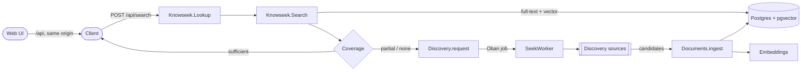
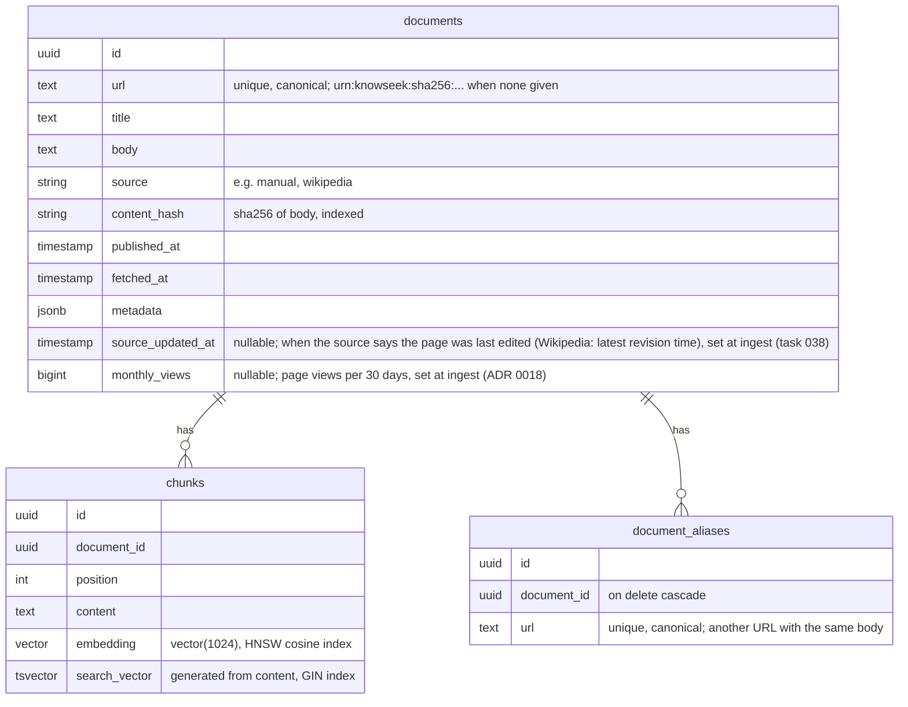

# Architecture

## Overview



A search returns right away with whatever the index has. Discovery runs in the background, so its results are available to later searches, not to the search that triggered it. (Pushing late results to the caller is a backlog task.)

## Components

All modules live in `backend/lib/knowseek/`.

| Module | Responsibility |
| --- | --- |
| `Knowseek.Lookup` | Entry point for a query. Searches, then requests discovery if coverage is not sufficient. |
| `Knowseek.Search` | Read-only hybrid search over chunks. Full-text (`tsvector`) and vector (cosine, HNSW) results are merged with reciprocal rank fusion. Chunks that are not relevant are dropped, so an uncovered query returns no hits. The rest are grouped by document: one hit per document, scored by its best chunk (never a sum), with up to `max_passages` other matching chunks in `passages` (`chunk_id`, `content`, `score`). Then a bounded prior from the document's `monthly_views` multiplies that score and the hits are sorted again (see "Ranking prior"). |
| `Knowseek.Search.Coverage` | Pure heuristic that classifies a hit list as `:sufficient`, `:partial`, or `:none`. Each hit is one document, so it counts documents with a relevant, fresh hit. With `max_age_seconds`, it counts only documents whose `fetched_at` is within that many seconds. |
| `Knowseek.Documents` | The only write path into the index. Validates, canonicalizes the URL, chunks, embeds, and stores documents. Re-ingesting a URL updates it. `source_updated_at` (when the source says the page was last edited) is stored like `monthly_views`: a candidate without it leaves the stored value alone, and an unchanged body still updates it, because the field means "the source says last edited" and not "our text changed". A body that is long enough (`min_alias_body_length/0`) and already stored under another URL is not a new document: the URL becomes an alias of the stored one, and only that document's `fetched_at` moves (a document that has only a `urn:` URL takes the real URL instead). An alias URL that later serves a different body loses its alias and becomes a new document. An unchanged body at a document's own URL is not re-chunked or re-embedded, but the other fields and `fetched_at` are updated. See `docs/decisions/0013-url-canonicalization-and-aliases.md`. |
| `Knowseek.Documents.URL` | Pure URL canonicalization: lowercase scheme and host, no fragment, no default port, no tracking parameters (`utm_*`, `fbclid`, ...), sorted query. The tracking list lives there. |
| `Knowseek.Documents.Chunker` | Splits a body into chunks of at most ~1200 characters on paragraph and word boundaries. |
| `Knowseek.Embeddings` | Behaviour plus dispatcher for embedding providers. Takes `input_type: :document \| :query`. Adapters, selected by `EMBEDDINGS_ADAPTER`: `Embeddings.Ollama` (local `bge-m3` through Ollama, free; the default, ADR 0016), `Embeddings.Hashing` (local stand-in, no semantics; the opt-out and the adapter in tests), `Embeddings.Voyage` (Voyage AI API). |
| `Knowseek.Discovery` | Enqueues and runs discovery. Calls each configured `Discovery.Source` and ingests the candidates. |
| `Knowseek.Discovery.Source` | Behaviour for an external data source. |
| `Knowseek.Discovery.Sources.Wikipedia` | Searches English Wikipedia (MediaWiki API) and returns the plain text of the top 3 articles, capped at ~40k characters each, with each article's views per 30 days (`monthly_views`, from `prop=pageviews` in the same request) and the time of its latest revision (`source_updated_at`, from `prop=revisions` in the same request). Skips disambiguation pages. |
| `Knowseek.Entities` | Entity resolution (task 030, ADR 0017). `resolve(query, opts)` turns a query into `{:ok, %{intent, entity, alternatives}}`, `:none`, `{:pending, query}` (cold cache) or `{:error, reason}`. It reads only the cache; a cold query starts one background fetch. `Entities.Intent` splits `weather in <place>` and `<place> weather` into intent `:weather` and the place. `Entities.Resolver` is the behaviour for a resolver; `Entities.Wikidata` (`wbsearchentities` for candidates, one `wbgetentities` for claims) is the configured one. The top entity is the first candidate whose type a card provider handles (`kind/1`, the `supported_types` config); the other candidates of that kind, at most 5, are the alternatives. `Entities.Entity` is the struct. |
| `Knowseek.Cache` | A disposable in-memory cache (ETS) with a supervised background refresher: `get(cache, key, fetch_fun, opts)` never fetches in the caller. Single-flight per key, TTL (a number or a function of the value), stale-while-revalidate, the old value kept on failure, a backoff after a failure, a fetch timeout, a cap on entries, a cap on concurrent fetches (`max_in_flight`: a refresh over the cap is dropped, the next `get` asks again), and a cache-wide stop on a rate limit (a fetch that fails with `{:rate_limited, ms}`, see `Cache.rate_limited/1`, stops every fetch of that cache for `Retry-After`, at most ten minutes). Entity resolution (`Knowseek.Entities.Cache`) and the cards (`Knowseek.Cards.Cache`, `Knowseek.Cards.EspnTeams`) each use an instance. |
| `Knowseek.Cards` | Live fact cards (task 031, ADR 0017). `get(entity, opts)` returns `:none` (no provider handles the entity) or `%{status, type, title, facts, as_of, refresh_after_ms}` with status `fresh`, `stale`, `pending` or `unavailable`. It reads only the cache and never calls a provider: a cold or expired card starts one background fetch. `Cards.Provider` is the behaviour (`handles?/1`, `fetch/1` returning `{:ok, card, ttl_ms}`); the providers are the `providers` config. `Cards.Providers.EspnNba` (with `Cards.Espn`, the HTTP client) makes the NBA team card. |
| `KnowseekWeb.*` | JSON API. Controllers are thin and call the contexts above. `CardController` (`GET /api/cards?q=`) composes `Entities.resolve/2` and `Cards.get/2`. |
| `frontend/` | Web UI (Vite, React, TypeScript). A client of the JSON API. See below. |

## Web UI

`frontend/` holds a single-page app. In development, Vite serves it and proxies `/api` to the Phoenix API, so the browser sees one origin and the API needs no CORS. The app keeps its state in the URL (`/?q=...&doc=...`), so searches can be shared.

Because the API does not yet tell callers when discovery finishes (task 006), the UI watches the index. After a search that enqueued discovery, it polls `GET /api/documents` for new document ids. When some arrive, it searches again and marks the new results. It stops when no new documents arrive for a while, or after 90 seconds. Task 006 replaces this polling. See `docs/decisions/0008-web-frontend.md`.

## Data model



Oban stores its jobs in `oban_jobs` in the same database.

## Background jobs (Oban)

| Queue | Workers | Notes |
| --- | --- | --- |
| `discovery` | `Discovery.SeekWorker` | Unique per normalized query for 1 hour. 3 attempts. |

## Ranking prior

[ADR 0018](decisions/0018-ranking-prior.md). After chunk fusion and grouping, `Knowseek.Search` multiplies each document's score by a factor from `documents.monthly_views` and sorts again (a stable sort, so equal scores keep the fused order):

```
factor = 1 + prior_weight * min(1, log10(1 + views) / log10(1 + prior_saturation_views))
score  = best_chunk_rrf_score * factor
```

- The factor is between 1.0 and `1 + prior_weight` (1.3 by default). It never lowers a score, so relevance dominates: a document at rank 1 in both lists (2/61) is overtaken only by one within about 20 ranks of it. A document with no figure (`NULL`) gets exactly 1.0 and ranks as before. `prior_weight: 0` turns the prior off. Both knobs can be passed to `Search.search/2`.
- 81,520 views give 1.245 and 6,276 give 1.190, a 4.6% lead.
- The figure is taken at ingest (the Wikipedia source reads it from the same API call as the text) and written by `Documents.ingest/1`. It is refreshed only when the document is re-ingested. No mechanism re-fetches an existing document, so the figure can be old. Decided 2026-10-31: no re-fetch for now; revisit when a source where age matters is added (ADR 0018).
- `Hit.score` includes the factor. `passages[].score` do not.

## Live fact cards (built for NBA teams; companies and weather not built yet)

[ADR 0017](decisions/0017-live-fact-cards.md) decides that a query about an entity with live state gets a card of structured facts above the ranked results. Built: entity resolution (task 030, `Knowseek.Entities`, `Knowseek.Cache`) and the card framework with the NBA team card (task 031, `Knowseek.Cards`, `GET /api/cards`, the card above the results in the UI). Not built: the company card (task 032), the weather card (task 033), other leagues, and push instead of polling. The design:

- Entities are resolved through Wikidata (task 030). Cards come from swappable provider behaviours: ESPN now; a Yahoo-style chart endpoint and Open-Meteo later.
- The endpoint is cache-only. It reads in-memory caches and never calls a provider or Wikidata in the request path. Its response has `status` (`fresh`, `stale`, `pending`, `unavailable`, `none`), `as_of`, `refresh_after_ms` and the card data.
- A supervised in-process refresher fills the cache, single-flight per entity, with a short timeout and a backoff. The UI polls. Nothing runs when nobody is looking. The cache is disposable: no Oban job, no table. `Knowseek.Cache` is this mechanism: `resolve/2` returns `{:pending, query}` on a cold query and `Cards.get/2` returns `status: :pending` on a cold card, and the caller asks again.
- Rule 6 in `AGENTS.md` is amended accordingly. The request path never calls an external provider, except query embedding in `Search`. Index writes still go through Oban.

### Entity resolution

`Entities.resolve/2` splits the intent word off (`weather in tokyo` gives `:weather` and `tokyo`), then reads the cache entry for the lowercased text. A cold entry starts a fetch: one `wbsearchentities` call (20 candidates), one `wbgetentities` call for all of their claims and sitelinks, then the choice of the top entity. The result, including "no match", is cached for a day. A failure (HTTP 429, timeout) is `{:error, reason}` when nothing is cached, and the old answer is kept when something is. No new fetch starts for a minute after a failure.

An entity has a *kind* when a type it is an instance of (P31) is in the `supported_types` config for that kind and it has what the provider needs: a company needs an exchange ticker (P414 with the P249 qualifier), a place needs coordinates (P625), a sports team needs nothing more. The list is flat on purpose: Tokyo is a "big city" and a "megacity", not a "city". The config lists the ids seen in the probes.

### Cards and the endpoint

`GET /api/cards?q=<query>` (`KnowseekWeb.CardController`) resolves the query to an entity (`Entities.resolve/2`), asks `Cards.get/2` for its card, and answers `{data: {status, entity, alternatives, card, as_of, refresh_after_ms}}`. The query is the key, so the UI needs no entity id. Both steps read caches, so a cold query is `pending` twice in a row: first the entity, then the card, one poll apart. `none` means the query names no entity that has a card (a company or a place today, a G League team, text that is not a name): the UI shows nothing. `unavailable` means a source failed and nothing was ever cached. `stale` means a card past its TTL is served while the refresh runs or after it failed, with its old `as_of`. `refresh_after_ms` is when to ask again: 0.7 s for `pending`, the time the card has left (2-60 s) for `fresh`, 2 s for `stale` (a refresh that runs finishes in a second; the UI shows the stale notice only if the card is still stale one poll later, so a normal refresh does not flash it), 30 s for `unavailable`. The UI (`useCard`) polls on these times, pauses while the tab is hidden, stops on `none` at once, and retries `unavailable` and failed requests after 5, 15 and 30 s before it gives up.

The NBA team card (`Cards.Providers.EspnNba`) handles an entity that is a sports team and whose Wikidata league (P118, no ended claims) includes the NBA (Q155223). The league decides, not the label: the Westchester Knicks (G League) and the former Denver Nuggets (an NBL team whose NBA claim has an end date) get no card. The label is then matched to ESPN's `displayName` in the NBA `/teams` list (cached for a day; `Los Angeles Clippers` is `LA Clippers`). A card needs two parallel ESPN requests, `/teams/<id>/schedule` (record, the game in progress, the last completed game, the next game) and `/teams/<id>/roster` (injuries). While a game is in progress ESPN's `/schedule` sometimes lists it without scores (seen 2026-10-31); then one `/summary?event=<id>` (about 380 KB) supplies the scores and the clock. No news. The TTL follows the state: 15 s while a game is in progress (ESPN caches for a few seconds), up to 6 hours after a final, up to an hour while a game is scheduled, never past 2 minutes before the next start and never under a minute. A request has a 4 s timeout, the whole fetch 12 s, and a failure backs off for 10 s.

Two limits protect the upstreams from user input (the query is user input). The entity cache normalizes its key (lowercase, NFKC, single spaces), drops text that is not a printable name before any fetch, keeps at most 5000 entries, and runs at most 4 Wikidata resolutions at once (a refresh over the cap is dropped, the key stays `pending`, the next poll asks again). A 429 or `maxlag` from Wikidata or ESPN, with its `Retry-After`, stops every fetch of that cache until the time is up. Junk queries can still evict real entries once 5000 distinct queries are cached (the oldest are dropped first); there is no per-client rate limit yet.

## Configuration

`backend/config/config.exs` holds the knobs:

- `Knowseek.Embeddings`: `adapter`, `dimensions` (must match the migration).
- `Knowseek.Embeddings.Ollama`: `base_url`, `model`, `max_batch_size`, `req_options`. Set from `OLLAMA_URL` and `OLLAMA_MODEL` in `config/runtime.exs`.
- `Knowseek.Embeddings.Voyage`: `model`, batch limits, `req_options`. `api_key` comes from `VOYAGE_API_KEY` in `config/runtime.exs`.
- `Knowseek.Search`: `default_limit`, `candidate_factor` (each ranked list fetches `limit * candidate_factor` chunks before grouping by document; 40, roughly the chunk count of a long Wikipedia article; manual documents have no size cap, so it is a heuristic, not a guarantee), `max_passages` (3), `min_similarity`, `min_strong_hits`, `max_age_seconds`, `prior_weight` (0.3), `prior_saturation_views` (1,000,000; see "Ranking prior"). `min_similarity` is the relevance floor: a hit is returned and counted for coverage only if it matched the full-text search or has at least this cosine similarity. It depends on the embedding model (see `docs/decisions/0009-search-returns-only-relevant-hits.md`). `min_strong_hits` and `max_age_seconds` tune the coverage heuristic. `max_age_seconds` is the default freshness need for a search; `nil` ignores age. `POST /api/search` can override it per request; `null` there ignores age.
- `Knowseek.Discovery`: `sources` (list of modules). `config/test.exs` sets `sources: []`, so tests never call a real source. A test that needs a source passes `sources:` to `Discovery.run/2`.
- `Knowseek.Discovery.Sources.Wikipedia`: `base_url`, `limit`, `max_chars`, `user_agent`, `req_options` (tests put the `Req.Test` plug here).
- `Knowseek.Entities`: `resolver` (a `Knowseek.Entities.Resolver` module, Wikidata by default), `ttl` (a day), `backoff` (a minute) and `timeout` (15 seconds) for the cache, `max_alternatives` (5), `max_query_length` (100: a longer query is `:none`), `supported_types` (kind to Wikidata `instance of` ids; the ids seen in the probes are listed in `config/config.exs`), `cache` (start options of the cache: `max_entries` 5000, `max_in_flight` 4). `Knowseek.Cache` also takes `clock`, for tests.
- `Knowseek.Entities.Wikidata`: `base_url`, `search_limit` (20), `user_agent`, `req_options` (tests put the `Req.Test` plug here).
- `Knowseek.Cards`: `providers` (modules that implement `Knowseek.Cards.Provider`, tried in order), `backoff` (10 s) and `timeout` (12 s) for the cache, `cache` (`max_entries` 1000, `max_in_flight` 8).
- `Knowseek.Cards.Espn`: `base_url`, `user_agent`, `receive_timeout` (4 s), `req_options` (tests put the `Req.Test` plug here).
- `Oban`: the `discovery` queue and the pruner.

Secrets (API keys) go in `config/runtime.exs`, read from environment variables.

## Deployment

The backend builds into a Mix release image (`backend/Dockerfile`). `docker compose --profile app up --build` runs it next to the compose Postgres. The container creates its database, runs the migrations (`Knowseek.Release.migrate/0`, which includes `CREATE EXTENSION vector`), and serves the API. Environment variables are listed in `README.md`. The image has no web UI yet (task 018). See `docs/decisions/0014-release-and-container.md`.

## Known limitations

- With `EMBEDDINGS_ADAPTER=hashing` (the opt-out), search matches words, not meaning. The default needs a running Ollama; when it is down, ingest and search return an error (HTTP 503 from the API) and discovery jobs are retried, instead of falling back (ADR 0016).
- Chunks are not re-embedded when the embedding adapter changes.
- Wikipedia is the only discovery source, so discovery finds only encyclopedic data.
- No authentication and no users.
- The caller is not told when discovery finishes. The web UI polls for new documents instead.

Each limitation has a task in `docs/tasks/`.
