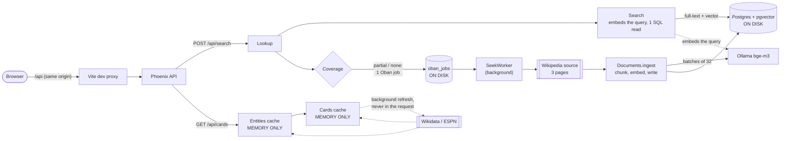

# Data and jobs

What Knowseek stores, how big it gets, and what runs in the background. Written for someone who has not read the code. For the components see [`ARCHITECTURE.md`](ARCHITECTURE.md); for the rules, [`../AGENTS.md`](../AGENTS.md).

Numbers in this page were **measured on 2026-11-01** on a developer laptop (Apple silicon, Postgres 17.11 with pgvector 0.8.7 in Docker, local Ollama with `bge-m3`, real English Wikipedia over the network), in a throwaway database holding 43 Wikipedia articles. Timings depend on the machine and the network; sizes do not. How to repeat them is in [section 6](#6-how-to-look-at-it-yourself).

## 1. Overview



Two separate paths:

- **Search path** (solid): the request reads the index and returns right away with what it has. If the index does not cover the query well enough, it enqueues one background job. That job fetches Wikipedia pages and writes them to Postgres, so a *later* search finds them. Everything on this path is on disk ([ADR 0002](decisions/0002-postgres-pgvector.md), [0003](decisions/0003-hybrid-search.md), [0006](decisions/0006-freshness-aware-coverage.md)).
- **Card path** (dotted lines are background work): `/api/cards` reads two in-memory caches and nothing else. A cold or expired entry starts a background refresh in the Phoenix process; the UI polls. No table, no Oban job, nothing survives a restart ([ADR 0017](decisions/0017-live-fact-cards.md)).

Planned and not built yet: the company card (task [032](tasks/032-company-card.md)), the weather card (task [033](tasks/033-weather-card.md)) and rate limiting of anonymous endpoints (task [039](tasks/039-rate-limit-anonymous-endpoints.md)). They are not covered by the numbers below.

## 2. Database tables

All tables are in one Postgres database (one per workspace, [ADR 0005](decisions/0005-per-workspace-databases.md)). The backend owns the schema; migrations are in `backend/priv/repo/migrations/`. The old `topics` table was created and dropped again ([ADR 0015](decisions/0015-remove-topics.md)); it does not exist on `main`.

| Table | What it is for | Written by | Rows grow with |
| --- | --- | --- | --- |
| `documents` | One row per source page (an article, a note). Holds the full text. | `Documents.ingest/1` only | pages ingested |
| `chunks` | The text of each document cut into pieces of at most about 1,200 characters, each with its embedding. The unit of search. | `Documents.ingest/1` only | about 23 per Wikipedia article (measured) |
| `document_aliases` | Other canonical URLs that served the same body as a document ([ADR 0013](decisions/0013-url-canonicalization-and-aliases.md)). | `Documents.ingest/1` only | duplicate URLs seen; 0 in the measurement |
| `oban_jobs` | The background job queue and its history ([section 4](#4-background-jobs-oban)). | Oban (`Discovery.request/1` inserts) | uncovered searches; pruned after 7 days |
| `oban_peers` | Oban's leader election: one row while the app runs. | Oban | does not grow |
| `schema_migrations` | Which migrations ran. | Ecto | one per migration (8) |

Only `Knowseek.Documents.ingest/1` writes `documents`, `chunks` and `document_aliases` (architecture rule 2). Discovery sources never write; they return candidates.

### `documents`

| Column | Notes |
| --- | --- |
| `id` | uuid primary key |
| `url` | Canonical URL, unique. A body with no URL gets `urn:knowseek:sha256:...`. |
| `title`, `body` | The whole text is in `body` (Wikipedia: at most about 40,000 characters, set by the source's `max_chars`). |
| `source` | `wikipedia`, `manual`, `seed`. |
| `content_hash` | sha256 of the body. Used to detect an unchanged re-fetch (no re-embedding) and the same body under a new URL (alias). |
| `fetched_at` | When Knowseek last saw the page. Search coverage uses it for freshness. |
| `source_updated_at` | Nullable. When the source says the page was last edited (Wikipedia: latest revision time). Set at ingest; shown in the UI. |
| `monthly_views` | Nullable bigint. Wikipedia page views per 30 days at ingest. Search turns it into a bounded ranking prior ([ADR 0018](decisions/0018-ranking-prior.md)). In the measurement, 40 of 43 documents have both fields (the 3 seed notes do not). |
| `published_at`, `metadata`, `inserted_at`, `updated_at` | Rarely used. |

Indexes: primary key, **unique on `url`**, plain index on `content_hash`.

### `chunks`

| Column | Notes |
| --- | --- |
| `document_id` | Foreign key, `ON DELETE CASCADE`. Unique together with `position`. |
| `position` | Order of the chunk in the document. |
| `content` | The chunk text. |
| `embedding` | `vector(1024)`: 1,024 four-byte floats, 4,100 bytes ([ADR 0004](decisions/0004-embeddings.md)). Fixed by the schema; another model size needs a migration and a re-embed. |
| `search_vector` | `tsvector`, generated from `content` with the `english` configuration. Never written by hand. |

Indexes: primary key, unique `(document_id, position)`, **GIN on `search_vector`** (full-text), **HNSW on `embedding` with `vector_cosine_ops`** (approximate nearest neighbour; ADR 0002, 0003).

### `document_aliases`

`document_id` (cascade delete), `url` (unique). Indexed on both. Empty unless two URLs served the same body.

### Relationships

```
documents 1 --- n chunks            (delete a document: its chunks go)
documents 1 --- n document_aliases  (delete a document: its aliases go)
oban_jobs, oban_peers               (no foreign keys; jobs carry the query as JSON args)
```

### Measured size

Database after the measurement: **43 documents, 993 chunks**, 26 MB in total. "Index" is every index on the table. "TOAST" is Postgres's side storage for large values (here the embedding, and compressed long text) including its own index. Heap is the main table file.

| Table | Rows | Total | Heap | Indexes | TOAST |
| --- | --- | --- | --- | --- | --- |
| `chunks` | 993 | 17.9 MB | 1.50 MB | 10.3 MB | 6.05 MB |
| `documents` | 43 | 0.79 MB | 0.04 MB | 0.05 MB | 0.67 MB |
| `oban_jobs` | 8 | 0.13 MB | 0.01 MB | 0.11 MB | 0.01 MB |
| `oban_peers` | 1 | 0.05 MB | 0.01 MB | 0.02 MB | 0.02 MB |
| `document_aliases` | 0 | 0.03 MB | 0 | 0.02 MB | 0.01 MB |
| `schema_migrations` | 8 | 0.02 MB | 0.01 MB | 0.02 MB | 0 |

(The three small tables are mostly one-page minimums; ignore them for planning.)

The `chunks` indexes, in bytes: HNSW 8,871,936, GIN 1,294,336, `(document_id, position)` 73,728, primary key 57,344. `documents` has three indexes of 16 KB each (primary key, `url`, `content_hash`).

Per chunk (`avg(pg_column_size(...))`):

| Part | Bytes |
| --- | --- |
| `embedding` | 4,100 (1,024 floats) |
| `content` (raw 950, stored 906) | 906 |
| `search_vector` | 1,072 |
| HNSW index entry (index size / chunks) | about 8,900 |
| GIN index entry (index size / chunks) | about 1,300 |
| **whole chunk, table + indexes** | **about 18.0 KB** (17.9 MB / 993) |

The index is the biggest part: the HNSW graph costs about twice the vector it indexes.

Per document, for the 43 articles measured: 23.1 chunks on average (min 1, max 44), body 21.9 KB on average (max 39,952 characters; stored 11.9 KB after Postgres compresses it), about **435 KB** per document (17.9 MB + 0.79 MB over 43). The text is stored twice: once whole in `documents.body` and once cut up in `chunks.content`, about 1 MB each across the 43 documents.

Formula (a Wikipedia article is at most about 40k characters, so at most about 44 chunks):

```
size per document  ≈ chunks_per_doc × 18.0 KB  +  ~18 KB  (the documents row: body + indexes)
                   ≈ 23.1 × 18.0 + 18  ≈ 435 KB
HNSW part          ≈ chunks × 8.9 KB
```

| Documents | Chunks (× 23.1) | Total on disk | HNSW index alone |
| --- | --- | --- | --- |
| 43 (measured) | 993 | 18.7 MB | 8.9 MB |
| 1,000 | 23,100 | 0.43 GB | 0.21 GB |
| 10,000 | 231,000 | 4.3 GB | 2.1 GB |
| 100,000 | 2.31 million | 43 GB | 21 GB |

This extrapolation assumes the same mix of long Wikipedia articles. The first measurement on the owner's database (2026-10-31, 14 documents, 246 chunks) had 18 chunks per article and about 340 KB per article; per chunk it agrees (about 18 KB). The difference per article is only that the articles I fetched for this page were longer on average (21.9 KB of body against 16.7 KB). Treat 340 to 435 KB as the range. The HNSW cost per chunk grew a little (8.1 KB to 8.9 KB per chunk) as the graph got bigger; I did not measure beyond 1,000 chunks, so the 100k figure is an extrapolation, not an observation.

### Growth

`documents` and `chunks` only grow when a search finds the index lacking and the background job finds new pages: at most 3 new documents per uncovered query (a query for a subject already covered fetches again but stores nothing new, see below). Nothing deletes them, by design ([ADR 0018](decisions/0018-ranking-prior.md) records "no re-fetch for now"). `oban_jobs` is pruned: finished jobs are deleted after 7 days.

## 3. In-memory caches (not tables)

Three `Knowseek.Cache` instances (ETS tables owned by the Phoenix process, [ADR 0017](decisions/0017-live-fact-cards.md)). They are disposable: everything is **lost on restart or deploy** and simply refilled by the next requests. Refreshes run in supervised tasks inside the app, not in Oban.

| Cache | Holds | Key | TTL | Limits |
| --- | --- | --- | --- | --- |
| `Entities.Cache` | The Wikidata entity chosen for a query (or "no match") with up to 5 alternatives | normalized query text (lowercase, NFKC, single spaces) | 24 h; after a failure, no new fetch for 1 min | 5,000 entries (oldest evicted first); at most 4 fetches in flight, extra refreshes are dropped; fetch timeout 15 s; queries over 100 characters are not cached |
| `Cards.Cache` | The finished card for an entity (NBA team today) | entity id | set by the provider: 15 s while a game is live, otherwise until the next game, at least 60 s and at most 1 h (6 h after a final) | 1,000 entries; 8 fetches in flight; backoff 10 s; timeout 12 s |
| `Cards.EspnTeams` | ESPN's NBA team list (maps a team name to its ESPN id) | `:nba` | 24 h | 10 entries; a list with fewer than 25 teams is rejected |

Stale values are served while a refresh runs ("stale-while-revalidate"), and the old value is kept when a refresh fails. A 429 or `maxlag` answer from Wikidata or ESPN pauses every fetch of that cache for the `Retry-After` (at most 10 minutes). Each entry is a small map (an NBA card is a few kilobytes), so the memory ceiling is a few megabytes; I did not measure it.

## 4. Background jobs (Oban)

Only one worker exists on `main` (`grep -rn "use Oban.Worker" backend/lib`):

| Worker | Queue | Concurrency | Attempts | Uniqueness | Triggered by | Pruner |
| --- | --- | --- | --- | --- | --- | --- |
| `Knowseek.Discovery.SeekWorker` | `discovery` | 5 at once (per node) | 3 | one per normalized query (lowercased, whitespace collapsed) while an earlier job of the same query, enqueued within the last hour, is still incomplete | `Lookup.run/2` when coverage is `partial` or `none` (`Discovery.request/1`) | completed, cancelled and discarded jobs are deleted after 7 days |

(Config: `backend/config/config.exs`, `Oban`, `queues: [discovery: 5]`, `Oban.Plugins.Pruner, max_age: 7 days`; the worker is `backend/lib/knowseek/discovery/seek_worker.ex`.)

**What one search costs in jobs.** A search that the index covers (`sufficient`) enqueues nothing. Any other search enqueues exactly one job. The same query while that job is still waiting or running reuses it (measured: two spellings of one query, `galileo galilei` and `  galileo   GALILEI `, got the same job id). The uniqueness covers only incomplete jobs, so once a job has completed, a repeat uncovered search enqueues a new job. That job fetches the pages again and finds the stored text unchanged: no new chunks, no embedding, and it finishes in about 1.1 s (measured, 3 repeat jobs).

**What a job does.** `Discovery.run/1` asks Wikipedia for the top 3 articles for the query one page at a time (skipping disambiguation pages), and passes each page to `Documents.ingest/1`, which chunks it, embeds all its chunks through Ollama (batches of 32), and writes the rows. The job ends `:ok` when at least one page ingested, or when nothing was found.

**Failure behaviour.**

- The embeddings provider (Ollama) is down: every `ingest` fails, and the job returns `{:error, {:all_ingests_failed, n}}`, so Oban retries it, 3 attempts in total, then marks it `discarded`. Measured with Ollama unreachable (connection refused): one attempt took 21.4 s, because each of the 3 pages retries 3 times with 1 s, 2 s and 4 s waits. A search at the same time returns an error (HTTP 503) within about 2 ms: the query embedding does not retry. No new job is enqueued by a discarded job; the next uncovered search enqueues one.
- Some pages ingest and some fail: the job is `:ok`; the failed pages are only logged.
- Wikipedia is unreachable or returns nothing: the source logs a warning and the job is `:ok` with 0 documents. There is no retry (a later search enqueues again).
- Documents already ingested are never undone by a failed job; each page is its own write.

**Measured durations** (Ollama `bge-m3` on the same laptop as the database, real Wikipedia):

| Case | Time |
| --- | --- |
| Whole job for an uncovered query, one job alone (4 queries) | 6.7 s, 7.2 s, 8.7 s, 10.4 s (3 pages each) |
| Same, four jobs started together (the queue allows 5) | 15.8 s to 19.6 s each: Ollama is the bottleneck, so concurrent jobs mostly queue behind it |
| Repeat of an already-ingested query | 1.1 s (fetch only) |
| Provider down, one attempt | 21.4 s, ending in `{:error, {:all_ingests_failed, 3}}` |

The owner's earlier four jobs took 2.7, 4.7, 7.7 and 9.2 s; the spread (2.7 to 19.6 s) comes from how many chunks the three pages hold, and from other work contending for Ollama on the laptop.

Stage timings for the same run (`:timer.tc`):

| Stage | Time | Notes |
| --- | --- | --- |
| Wikipedia fetch, search + 3 pages (sequential) | 0.6 to 1.0 s (5 queries) | the owner measured about 0.3 s earlier; network and `maxlag` vary |
| Chunking | 0.2 to 53 ms per document (typically under 10 ms) | pure CPU |
| Embedding a chunk (`bge-m3`) | about 85 to 125 ms per chunk, 112 to 155 ms for a single chunk | 5 chunks 0.56 s, 20 chunks 2.4 s, 32 chunks 4.0 s, 60 chunks 8.1 s (2 requests: 32 + 28). The owner measured about 70 ms per chunk; my run was slower because other work was using Ollama and the CPU at the same time |
| One 42-chunk article, embedding only | 3.4 to 3.8 s | |
| Database writes, one article (hashing adapter, so no embed wait) | 24 ms (6 chunks), 132 ms (41 chunks), 233 ms (42 chunks) | includes chunking and the hash; rolled back afterwards |
| Search request (`Search.search`, including embedding the query) | 40 to 110 ms | of which 33 to 88 ms is the Ollama query embedding; the SQL (HNSW + GIN) is the rest; an uncovered query takes about the same, 42 ms |

So embedding dominates: about 90% of a job and almost all of a search. Postgres writes are small by comparison.

## 5. What is not built, and what is pending

- No company card, weather card or rate limiting yet (tasks 032, 033, 039 are in progress). When they land, the card caches get more providers and the API gets per-client limits; this page has no numbers for them.
- No re-fetch of existing documents: a stored page is only updated when a query happens to fetch it again (`monthly_views` can be old; [ADR 0018](decisions/0018-ranking-prior.md)).
- Wikipedia is the only discovery source.
- Changing the embedding model does not re-embed chunks; it needs a migration and a rebuild ([ADR 0004](decisions/0004-embeddings.md)).
- The caller is not told when discovery finishes; the UI polls for new documents (task 006).

## 6. How to look at it yourself

The compose Postgres runs in the container `knowseek-db-1`. Replace `knowseek_dev` with your workspace database if you use a worktree (`knowseek_dev_<workspace>`). Read-only queries:

```sh
PSQL="docker exec knowseek-db-1 psql -U postgres knowseek_dev"

# rows and sizes per table: total, heap, indexes, TOAST
$PSQL -c "
select c.relname,
       pg_size_pretty(pg_total_relation_size(c.oid))       as total,
       pg_size_pretty(pg_relation_size(c.oid))             as heap,
       pg_size_pretty(pg_indexes_size(c.oid))              as indexes,
       pg_size_pretty(coalesce(pg_total_relation_size(c.reltoastrelid), 0)) as toast
from pg_class c join pg_namespace n on n.oid = c.relnamespace
where n.nspname = 'public' and c.relkind = 'r'
order by pg_total_relation_size(c.oid) desc"

# exact row counts (pg_class.reltuples is only an estimate)
$PSQL -c "select (select count(*) from documents) documents, (select count(*) from chunks) chunks, (select count(*) from document_aliases) aliases, (select count(*) from oban_jobs) jobs"

# every index and its size (the HNSW index is the big one)
$PSQL -c "select indexrelid::regclass as index, pg_size_pretty(pg_relation_size(indexrelid)) from pg_index where indrelid in ('chunks'::regclass, 'documents'::regclass) order by pg_relation_size(indexrelid) desc"

# bytes per chunk part, chunks per document, body size
$PSQL -c "select count(*), avg(pg_column_size(embedding))::int emb, avg(pg_column_size(content))::int content, avg(pg_column_size(search_vector))::int tsv from chunks"
$PSQL -c "select count(*) docs, avg(length(body))::int avg_body_chars, max(length(body)) max_body_chars, (select count(*)::numeric / nullif(count(distinct document_id), 0) from chunks) chunks_per_doc from documents"

# jobs: state counts and run time of finished jobs
$PSQL -c "select state, count(*) from oban_jobs group by state order by 2 desc"
$PSQL -c "select id, args->>'query' q, state, attempt, round(extract(epoch from completed_at - attempted_at)::numeric, 2) run_s from oban_jobs order by id desc limit 20"
$PSQL -c "select errors from oban_jobs where state in ('retryable', 'discarded') order by id desc limit 3"

# is the HNSW index still small enough for memory? compare with shared_buffers
$PSQL -c "show shared_buffers" -c "select pg_size_pretty(pg_relation_size('chunks_embedding_vector_cosine_ops_index'))"
```

From the Elixir side (run from `backend/` through the Makefile's environment, for example `make iex`):

```elixir
Knowseek.Repo.aggregate(Knowseek.Documents.Document, :count)
Knowseek.Cache.stats(Knowseek.Entities.Cache)   # entries and dropped refreshes
Oban.check_queue(queue: :discovery)             # running jobs and limit
```

To time a stage yourself, wrap it in `:timer.tc/1` in a `mix run` script, for example `:timer.tc(fn -> Knowseek.Discovery.Sources.Wikipedia.discover("alan turing", []) end)`. Use your own worktree database, set `EMBEDDINGS_ADAPTER=ollama` for that run, and expect real network calls.

## 7. Known limits and what would hurt first

1. **HNSW index fit in memory.** The vector index is about 8.9 KB per chunk, half of the chunks table. Postgres answers a nearest-neighbour query quickly only while the graph pages are in memory (`shared_buffers`, plus the OS cache). With the default 128 MB `shared_buffers` that is roughly 15,000 chunks, 650 documents. Beyond that the OS cache has to carry it. At about 100k documents the index is about 21 GB (extrapolated, not measured); queries slow down well before that on a small host. Search tests that load many chunks can even bloat a long-lived local index (see AGENTS.md "Testing rules"). Index build time and query time at scale were not measured.
2. **The body is stored twice.** Once whole in `documents.body`, once cut up in `chunks.content`, about 2 MB per 43 articles. It is cheap next to the vectors (under 10% of the bytes), and the whole body is what `GET /api/documents/:id` returns, so it stays for now.
3. **No eviction and no re-fetch, by design.** Nothing deletes a document and nothing refreshes it ([ADR 0018](decisions/0018-ranking-prior.md)). Pages go stale (`fetched_at`, `source_updated_at` show how stale), `monthly_views` ages, and disk only grows. Deleting a document cascades to its chunks and aliases but leaves the HNSW graph to be vacuumed.
4. **Embedding is the throughput limit.** Roughly 100 ms per chunk, about 4 s per 40-chunk article, one Ollama doing the work: 4 concurrent jobs took 16 to 20 s each instead of 7 s. The queue's limit of 5 does not make it five times faster. A hosted provider ([ADR 0007](decisions/0007-embedding-providers.md)) changes this; I did not measure it.
5. **The entity cache cap.** 5,000 entries and 4 fetches in flight, with user input as the key. Many distinct junk queries can keep real queries `pending` and evict real entries; the fix is task [039](tasks/039-rate-limit-anonymous-endpoints.md) (rate limiting), not built yet. A Wikidata 429 pauses entity resolution for every client for up to 10 minutes.
6. **Anyone can enqueue jobs.** There is no authentication and no rate limit on `/api/search`, so each distinct uncovered query is one job and up to 3 stored articles (about 1.3 MB). That is the main way the database can be made to grow quickly (also task 039).
7. **Fixed embedding size.** `vector(1024)`: another model needs a migration and re-embedding all chunks, with the index rebuilt.
8. **Caches are lost on restart.** After a deploy every card is `pending` for a poll or two.
